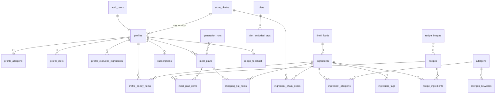

# Platewise – tietomalli

Postgres-tietomalli (Supabase) MVP:lle. Pohjana [PLAN.md](PLAN.md) ja [CLAUDE.md](../CLAUDE.md):n arkkitehtuuriperiaatteet. Tämä on suunnitelma; varsinainen toteutus tehdään Supabase-migraatioina.

## Yleiset linjaukset

| Asia | Linjaus |
|---|---|
| Tunnisteet | Käyttäjä- ja transaktiodata: `uuid` (`gen_random_uuid()`). Pienet viitetaulut (allergeenit, ruokavaliot, ketjut): `text`-koodi pääavaimena, esim. `'milk'`, `'vegan'`, `'lidl'`. |
| Raha | Kokonaislukuina sentteinä (`integer`, pääte `_cents`). Ei liukulukuja. |
| Määrät | Grammoina `numeric(8,2)` (pääte `_g`). Nesteet muunnetaan grammoiksi ainesosan tiheydellä tuonnissa. |
| Aika | `timestamptz`, aina UTC. Viikko = maanantaina alkava `date` (`week_start`). |
| Aikaleimat | Jokaisessa taulussa `created_at`, muokattavissa tauluissa `updated_at` (triggeri). |
| Kirjoitukset | Kaikki generointi, hinnoittelu ja viitedatan ylläpito tehdään Edge Functioneista `service_role`-avaimella (ohittaa RLS:n). Mobiilisovellus kirjoittaa suoraan vain omaan profiiliinsa, ruokavaliovalintoihinsa, perusvaroihinsa, palautteeseensa ja ostoslistan rasteihin. |
| RLS | Päällä **jokaisessa** taulussa. Taulu ilman policyja = vain backend pääsee käsiksi. |
| Tilin poisto | `auth.users`-poisto kaskadoi kaikkeen käyttäjädataan (`ON DELETE CASCADE`). Kustannusseuranta säilyy anonymisoituna (`ON DELETE SET NULL`). |

## Suhteet yleiskuvana

Taulut jakautuvat neljään ryhmään:

1. **Viitedata** (jaettu, vain luku): kaupat, Fineli, ainesosat, allergeenit, ruokavaliot
2. **Käyttäjädata** (oma, osin terveystietoa): profiili, allergiat, ruokavaliot, perusvarat, tilaus
3. **Reseptit** (jaettu, uudelleenkäytettävä): reseptit, ainesosat, kuvat
4. **Suunnitelmat ja seuranta** (oma / backend): viikkolistat, ostoslistat, palaute, generointiajot

---

## 1. Viitedata

### `store_chains`
Kauppaketjut ja niiden hintatasokerroin.

| Kenttä | Tyyppi | Huom. |
|---|---|---|
| `code` | `text` PK | `'lidl'`, `'prisma'`, `'k_market'`, `'k_citymarket'`, `'s_market'` |
| `name` | `text` NOT NULL | Näytettävä nimi |
| `price_multiplier` | `numeric(4,3)` NOT NULL | Esim. `0.850`, `1.000`, `1.150`; CHECK > 0 |
| `logo_path` | `text` | Polku Storageen |
| `sort_order` | `smallint` | Onboardingin järjestys |
| `is_active` | `boolean` NOT NULL DEFAULT true | |

### `fineli_foods`
Fineli-tuonti. Arvot per 100 g syötävää osaa.

| Kenttä | Tyyppi | Huom. |
|---|---|---|
| `fineli_id` | `integer` PK | Finelin oma FOODID |
| `name_fi` | `text` NOT NULL | |
| `energy_kcal` | `numeric(7,2)` NOT NULL | |
| `protein_g` | `numeric(6,2)` NOT NULL | |
| `carbs_g` | `numeric(6,2)` NOT NULL | Hiilihydraatit imeytyvät |
| `fat_g` | `numeric(6,2)` NOT NULL | |
| `fiber_g` | `numeric(6,2)` | |
| `sugar_g` | `numeric(6,2)` | |
| `saturated_fat_g` | `numeric(6,2)` | |
| `salt_g` | `numeric(6,2)` | |
| `source_version` | `text` NOT NULL | Fineli-julkaisun versio |
| `imported_at` | `timestamptz` NOT NULL | |

### `ingredients`
**Suljettu ainesosalista.** Tekoäly saa viitata vain tämän taulun aktiivisiin riveihin.

| Kenttä | Tyyppi | Huom. |
|---|---|---|
| `id` | `uuid` PK | |
| `slug` | `text` UNIQUE NOT NULL | Promptissa käytettävä vakaa tunniste, esim. `chicken_breast` |
| `name_fi` | `text` NOT NULL | |
| `fineli_id` | `integer` NOT NULL FK → `fineli_foods` | Pakollinen: ilman sitä makroja ei voi laskea |
| `shop_section` | enum `shop_section` NOT NULL | Ostoslistan ryhmittely: `produce`, `meat_fish`, `dairy_eggs`, `bakery`, `dry_goods`, `canned`, `frozen`, `spices_oils`, `other` |
| `display_unit` | enum `display_unit` NOT NULL | `g`, `ml`, `pcs`, `tbsp`, `tsp` – miten määrä näytetään |
| `grams_per_unit` | `numeric(8,2)` | Pakollinen, jos `display_unit` ≠ `g` (esim. 1 sipuli = 80 g) |
| `base_price_per_kg_cents` | `integer` NOT NULL | Perushinta kertoimella 1,0; CHECK > 0 |
| `package_size_g` | `numeric(8,2)` NOT NULL | Tyypillinen pakkauskoko ostoslistaa varten |
| `pantry_eligible` | `boolean` NOT NULL DEFAULT false | Voiko käyttäjä lisätä ainesosan perusvaroihinsa (säilyvät kuivatuotteet, öljyt, mausteet) |
| `is_default_pantry` | `boolean` NOT NULL DEFAULT false | Kuuluu oletusperusvaroihin: öljy, suola, pippuri, sokeri, vehnäjauho, peruskuivamausteet. CHECK: `NOT is_default_pantry OR pantry_eligible` |
| `price_reviewed_at` | `date` NOT NULL | Milloin hinta tarkistettu viimeksi |
| `is_active` | `boolean` NOT NULL DEFAULT true | Passivointi, ei poistoa (resepteillä viittauksia) |

### `ingredient_chain_prices`
Valinnainen ketjukohtainen ylikirjoitus, kun pelkkä kerroin ei riitä (esim. Lidlin oma merkki selvästi halvempi).

| Kenttä | Tyyppi | Huom. |
|---|---|---|
| `ingredient_id` | `uuid` FK → `ingredients` | PK (`ingredient_id`, `chain_code`) |
| `chain_code` | `text` FK → `store_chains` | |
| `price_per_kg_cents` | `integer` NOT NULL | CHECK > 0 |
| `reviewed_at` | `date` NOT NULL | |

**Hintakaava:** `hinta/kg = coalesce(ingredient_chain_prices.price_per_kg_cents, round(base_price_per_kg_cents × price_multiplier))`. Laskenta tehdään backendissä yhdessä paikassa (yksikkötestattu funktio).

### `allergens`
EU:n 14 pakollista allergeeniryhmää (+ tarvittaessa lisäyksiä).

| Kenttä | Tyyppi | Huom. |
|---|---|---|
| `code` | `text` PK | `gluten`, `crustaceans`, `egg`, `fish`, `peanut`, `soy`, `milk`, `tree_nuts`, `celery`, `mustard`, `sesame`, `sulphites`, `lupin`, `molluscs` |
| `name_fi` | `text` NOT NULL | |
| `sort_order` | `smallint` | |

### `ingredient_allergens`
Mitä allergeeneja ainesosa sisältää. **Allergiatarkistuksen ensisijainen lähde.**

| Kenttä | Tyyppi | Huom. |
|---|---|---|
| `ingredient_id` | `uuid` FK → `ingredients` | PK (`ingredient_id`, `allergen_code`) |
| `allergen_code` | `text` FK → `allergens` | |
| `may_contain` | `boolean` NOT NULL DEFAULT false | "Saattaa sisältää" -jäämät; tiukka tila voi hylätä nämäkin |

### `allergen_keywords`
Toissijainen varmistus: reseptin vapaat tekstit (nimi, kuvaus, vaiheet) skannataan näillä sanoilla. Estää tilanteen, jossa tekoäly mainitsee vaiheissa ainesosan, jota ei ole ainesosalistassa ("ripottele päälle cashew-pähkinöitä").

| Kenttä | Tyyppi | Huom. |
|---|---|---|
| `id` | `uuid` PK | |
| `allergen_code` | `text` FK → `allergens` | |
| `keyword` | `text` NOT NULL | Pienaakkosin, vartalo: `pähkinä`, `cashew`, `maapähkinä`, `vehnä`, `maito`, `kerma`… |
| `except_phrases` | `text[]` NOT NULL DEFAULT `'{}'` | Ilmaukset, jotka poistetaan tekstistä ennen hakua, esim. `maito` → `{kookosmaito, kauramaito}`. Estää turhat hylkäykset; lisätään vain tarkistetusti. |
| | | UNIQUE (`allergen_code`, `keyword`) |

### `ingredient_tags`
Ruokavaliotarkistuksen tagit (ei allergeeneja).

| Kenttä | Tyyppi | Huom. |
|---|---|---|
| `ingredient_id` | `uuid` FK → `ingredients` | PK (`ingredient_id`, `tag`) |
| `tag` | enum `ingredient_tag` | `meat`, `pork`, `beef`, `poultry`, `fish`, `seafood`, `dairy`, `lactose`, `egg`, `honey`, `gelatin`, `alcohol` |

### `diets`

| Kenttä | Tyyppi | Huom. |
|---|---|---|
| `code` | `text` PK | `vegan`, `vegetarian`, `pescatarian`, `lactose_free`, `pork_free`, `alcohol_free` |
| `name_fi` | `text` NOT NULL | |
| `sort_order` | `smallint` | |

### `diet_excluded_tags`
Ruokavalion säännöt datana, jotta ne ovat testattavissa ja muokattavissa ilman koodimuutosta.

| Kenttä | Tyyppi | Huom. |
|---|---|---|
| `diet_code` | `text` FK → `diets` | PK (`diet_code`, `tag`) |
| `tag` | enum `ingredient_tag` | Esim. `vegan` → `meat`, `pork`, `beef`, `poultry`, `fish`, `seafood`, `dairy`, `lactose`, `egg`, `honey`, `gelatin` |

> Gluteeniton ei ole ruokavalio vaan allergia (`gluten`), jotta se kulkee saman tiukan tarkistuksen läpi.

---

## 2. Käyttäjädata

### `profiles`
Yksi rivi per käyttäjä. Luodaan triggerillä `auth.users`-insertin yhteydessä.

| Kenttä | Tyyppi | Huom. |
|---|---|---|
| `id` | `uuid` PK, FK → `auth.users` ON DELETE CASCADE | |
| `household_size` | `smallint` NOT NULL DEFAULT 1 | CHECK IN (1, 2) |
| `weekly_budget_cents` | `integer` | CHECK BETWEEN 1000 AND 50000; NULL ennen onboardingia |
| `chain_code` | `text` FK → `store_chains` | NULL ennen onboardingia |
| `dinners_per_week` | `smallint` NOT NULL DEFAULT 5 | CHECK BETWEEN 3 AND 7 |
| `health_data_consent_at` | `timestamptz` | GDPR art. 9 -suostumus allergia- ja ruokavaliotiedoille. Ilman sitä allergioita ei voi tallentaa. |
| `onboarding_completed_at` | `timestamptz` | |
| `locale` | `text` NOT NULL DEFAULT `'fi'` | |

### `profile_allergens` *(terveystieto)*

| Kenttä | Tyyppi | Huom. |
|---|---|---|
| `user_id` | `uuid` FK → `profiles` ON DELETE CASCADE | PK (`user_id`, `allergen_code`) |
| `allergen_code` | `text` FK → `allergens` | |
| `strict` | `boolean` NOT NULL DEFAULT true | true = myös "saattaa sisältää" hylätään |

### `profile_diets` *(terveystieto)*

| Kenttä | Tyyppi | Huom. |
|---|---|---|
| `user_id` | `uuid` FK → `profiles` ON DELETE CASCADE | PK (`user_id`, `diet_code`) |
| `diet_code` | `text` FK → `diets` | |

### `profile_excluded_ingredients`
"En pidä näistä" -lista. Ei terveystieto, mutta käsitellään samoin säännöin.

| Kenttä | Tyyppi | Huom. |
|---|---|---|
| `user_id` | `uuid` FK → `profiles` ON DELETE CASCADE | PK (`user_id`, `ingredient_id`) |
| `ingredient_id` | `uuid` FK → `ingredients` | |

### `profile_pantry_items`
Käyttäjän perusvarat: ainesosat, joiden oletetaan löytyvän kotoa. Ne eivät tule ostoslistaan eivätkä budjettiin, ja reseptissä ne merkitään "kotoa".

| Kenttä | Tyyppi | Huom. |
|---|---|---|
| `user_id` | `uuid` FK → `profiles` ON DELETE CASCADE | PK (`user_id`, `ingredient_id`) |
| `ingredient_id` | `uuid` FK → `ingredients` | Vain `pantry_eligible = true` (tarkistetaan triggerillä) |

- Täytetään profiilin luonnissa kaikilla `is_default_pantry`-ainesosilla. Käyttäjä voi poistaa ja lisätä asetuksista.
- Perusvaroihin kuulumattomat mausteet ostetaan ja lasketaan budjettiin kokonaisina pakkauksina.
- Perusvarat eivät vaikuta allergiatarkistukseen: myös kotoa löytyvä vehnäjauho hylätään gluteeniallergikolta.

### `subscriptions`
Tilauksen tila. Kirjoittaa vain RevenueCat-webhookin Edge Function.

| Kenttä | Tyyppi | Huom. |
|---|---|---|
| `user_id` | `uuid` PK, FK → `profiles` ON DELETE CASCADE | RevenueCatin `app_user_id` = tämä |
| `status` | enum `subscription_status` NOT NULL | `trialing`, `active`, `in_grace_period`, `expired`, `cancelled`, `billing_issue` |
| `product_id` | `text` NOT NULL | Esim. `platewise_monthly`, `platewise_yearly` |
| `store` | enum `app_store` NOT NULL | `app_store`, `play_store` |
| `current_period_ends_at` | `timestamptz` NOT NULL | |
| `will_renew` | `boolean` NOT NULL | |
| `last_event_at` | `timestamptz` NOT NULL | Vanhempia webhook-tapahtumia ei sovelleta |

### `revenuecat_events`
Webhookien raakaloki idempotenssia ja vianselvitystä varten.

| Kenttä | Tyyppi | Huom. |
|---|---|---|
| `event_id` | `text` PK | RevenueCatin tapahtuma-ID; duplikaatit ohitetaan |
| `user_id` | `uuid` FK → `profiles` ON DELETE SET NULL | |
| `event_type` | `text` NOT NULL | |
| `payload` | `jsonb` NOT NULL | |
| `received_at` | `timestamptz` NOT NULL | |

---

## 3. Reseptit (jaettu)

Reseptit eivät kuulu kenellekään käyttäjälle. Sama resepti käytetään uudelleen kaikille yhteensopiville profiileille (periaate 6). Määrät tallennetaan **yhdelle annokselle** ja skaalataan `household_size`:lla.

### `recipes`

| Kenttä | Tyyppi | Huom. |
|---|---|---|
| `id` | `uuid` PK | |
| `title_fi` | `text` NOT NULL | |
| `description_fi` | `text` | Yksi lause |
| `steps_fi` | `jsonb` NOT NULL | Taulukko merkkijonoja; validoitu Zodilla ennen tallennusta |
| `cook_time_min` | `smallint` NOT NULL | CHECK BETWEEN 5 AND 120 |
| `difficulty` | enum `difficulty` NOT NULL | `easy`, `medium` (MVP: ei vaikeita) |
| `dish_type` | enum `dish_type` NOT NULL | `soup`, `stew`, `pasta`, `rice`, `potato`, `oven`, `stir_fry`, `salad`, `bowl`, `wrap`, `other`; vaihtelun ja kuvien uudelleenkäytön tunnistukseen |
| `good_for_leftovers` | `boolean` NOT NULL | Säilyykö ja lämpeneekö seuraavan päivän lounaaksi. Vain näitä tarjotaan "tee tuplana" -päiville. |
| `kcal_per_serving` | `numeric(7,1)` NOT NULL | **Laskettu Finelistä** tallennushetkellä, ei tekoälyltä |
| `protein_g_per_serving` | `numeric(6,1)` NOT NULL | 〃 |
| `carbs_g_per_serving` | `numeric(6,1)` NOT NULL | 〃 |
| `fat_g_per_serving` | `numeric(6,1)` NOT NULL | 〃 |
| `allergen_codes` | `text[]` NOT NULL | Johdettu `ingredient_allergens`ista (vain varmat). Uudelleenkäytön nopeaan suodatukseen. |
| `may_contain_codes` | `text[]` NOT NULL | Johdettu "saattaa sisältää" -allergeeneista |
| `ingredient_tags` | `ingredient_tag[]` NOT NULL | Johdettu `ingredient_tags`ista |
| `base_cost_per_serving_cents` | `integer` NOT NULL | Hinta kertoimella 1,0, uudelleenkäytön esisuodatukseen. Lopullinen hinta lasketaan ketjulle. |
| `image_id` | `uuid` FK → `recipe_images` ON DELETE SET NULL | NULL kunnes kuva valmis |
| `status` | enum `recipe_status` NOT NULL DEFAULT `'active'` | `active`, `retired` (esim. ainesosa passivoitu tai huono palaute) |
| `source_generation_id` | `uuid` FK → `generation_runs` ON DELETE SET NULL | Mistä ajosta syntyi |
| `prompt_version` | `text` NOT NULL | Promptin versio, jotta laatua voi verrata |
| `checks_version` | `text` NOT NULL | Minkä allergia- ja ruokavaliosääntöjen version läpi resepti meni |

Johdetut kentät (`allergen_codes`, `may_contain_codes`, `ingredient_tags`, makrot, `base_cost_…`) lasketaan backendissä uudelleen aina, kun reseptin ainesosat tai viitedata muuttuvat. **Allergiatarkistus ajetaan silti aina uudelleen ainesosatasolla** ennen kuin resepti päätyy käyttäjän listalle. Johdetut taulukot ovat vain esisuodatin.

**Rejected-reseptejä ei tallenneta tähän tauluun.** Tarkistuksessa hylätty tekoälyvastaus kirjataan vain `generation_runs`-riville.

### `recipe_ingredients`

| Kenttä | Tyyppi | Huom. |
|---|---|---|
| `recipe_id` | `uuid` FK → `recipes` ON DELETE CASCADE | PK (`recipe_id`, `position`) |
| `position` | `smallint` NOT NULL | Näyttöjärjestys |
| `ingredient_id` | `uuid` NOT NULL FK → `ingredients` | **Suljettu lista:** FK takaa, ettei tuntematonta ainesosaa voi tallentaa |
| `grams_per_serving` | `numeric(8,2)` NOT NULL | CHECK > 0 |
| `preparation_fi` | `text` | "hienonnettuna", "kuutioina" |
| | | UNIQUE (`recipe_id`, `ingredient_id`) |

### `recipe_images`

| Kenttä | Tyyppi | Huom. |
|---|---|---|
| `id` | `uuid` PK | |
| `dish_signature` | `text` NOT NULL | Normalisoitu avain samankaltaisten annosten tunnistukseen (esim. pääraaka-aineet + ruokatyyppi). Uusi resepti saa olemassa olevan kuvan, jos signature täsmää. |
| `status` | enum `image_status` NOT NULL | `queued`, `generating`, `ready`, `failed` |
| `storage_path` | `text` | Storage-polku, kun `ready` |
| `model` | `text` | |
| `prompt` | `text` | |
| `attempts` | `smallint` NOT NULL DEFAULT 0 | |
| `last_error` | `text` | |
| | | INDEX (`dish_signature`) WHERE `status = 'ready'` |

Tämä taulu toimii samalla kuvajonona: image-worker hakee `queued`-rivit (`FOR UPDATE SKIP LOCKED`).

---

## 4. Suunnitelmat, ostoslista ja seuranta

### `meal_plans`
Käyttäjän viikkolista. Asetukset tallennetaan **snapshottina**, koska profiilia voi muuttaa viikon aikana.

| Kenttä | Tyyppi | Huom. |
|---|---|---|
| `id` | `uuid` PK | |
| `user_id` | `uuid` NOT NULL FK → `profiles` ON DELETE CASCADE | |
| `week_start` | `date` NOT NULL | Maanantai; CHECK `extract(isodow from week_start) = 1` |
| `household_size` | `smallint` NOT NULL | Snapshot |
| `budget_cents` | `integer` NOT NULL | Snapshot |
| `chain_code` | `text` NOT NULL FK → `store_chains` | Snapshot |
| `estimated_total_cents` | `integer` | Ostoslistan summa (pakkauksina), päivitetään vaihdon jälkeen |
| `status` | enum `plan_status` NOT NULL | `generating`, `ready`, `failed` |
| `swaps_used` | `smallint` NOT NULL DEFAULT 0 | Viikon vaihtoraja (kustannuskontrolli) |
| | | UNIQUE (`user_id`, `week_start`) |

### `meal_plan_items`
MVP:ssä generoidaan vain päivällisiä. Lounas syntyy ainoastaan "tee tuplana → huomisen lounas" -valinnasta.

| Kenttä | Tyyppi | Huom. |
|---|---|---|
| `id` | `uuid` PK | |
| `meal_plan_id` | `uuid` NOT NULL FK → `meal_plans` ON DELETE CASCADE | |
| `day_index` | `smallint` NOT NULL | 0 = ma … 6 = su |
| `meal_slot` | enum `meal_slot` NOT NULL | `dinner`, `lunch` |
| `recipe_id` | `uuid` NOT NULL FK → `recipes` | Ei kaskadia: reseptejä ei poisteta, vain `retired` |
| `servings` | `smallint` NOT NULL | Päivällinen: `household_size`, tuplana `2 × household_size`. Lounas: `household_size`. |
| `cook_double` | `boolean` NOT NULL DEFAULT false | Vain päivälliselle. CHECK: `NOT cook_double OR (meal_slot = 'dinner' AND day_index < 6)` – sunnuntaita ei voi tuplata MVP:ssä, koska lounas osuisi seuraavalle viikolle. |
| `leftover_from_item_id` | `uuid` FK → `meal_plan_items` ON DELETE CASCADE | Lounasrivillä viittaus edellisen päivän tuplattuun päivälliseen; muilla NULL. CHECK: `(meal_slot = 'lunch') = (leftover_from_item_id IS NOT NULL)` |
| `estimated_cost_cents` | `integer` NOT NULL | Päivällisellä annosten osuus (sisältää tuplauksen). Lounaalla aina 0, koska kustannus on jo päivällisellä. |
| `replaced_recipe_id` | `uuid` FK → `recipes` | Täytetään vaihdossa, palautteeksi |
| | | UNIQUE (`meal_plan_id`, `day_index`, `meal_slot`) |

Tuplauksen kytkeminen päälle tai pois tehdään Edge Functionilla (`recalculate-plan`), joka luo tai poistaa lounasrivin ja laskee ostoslistan ja budjetin uudelleen. Sovellus ei kirjoita tähän tauluun suoraan.

### `shopping_list_items`
Backend muodostaa listan koko viikon ainesosista (tuplaukset mukaan lukien). Sama ainesosa yhdistetään yhdeksi riviksi ja pyöristetään pakkauksiin. Käyttäjän perusvarat (`profile_pantry_items`) jätetään listalta ja budjetista kokonaan pois. Lista lasketaan uudelleen (`recalculate-plan`), kun käyttäjä muuttaa perusvarojaan tai tuplausvalintoja.

| Kenttä | Tyyppi | Huom. |
|---|---|---|
| `id` | `uuid` PK | |
| `meal_plan_id` | `uuid` NOT NULL FK → `meal_plans` ON DELETE CASCADE | |
| `ingredient_id` | `uuid` NOT NULL FK → `ingredients` | |
| `total_grams` | `numeric(10,2)` NOT NULL | Tarve koko viikolle |
| `packages` | `smallint` NOT NULL | `ceil(total_grams / package_size_g)` |
| `estimated_cost_cents` | `integer` NOT NULL | `packages × package_size_g × kg-hinta`. **Tämä on budjettivertailun luku**, koska käyttäjä maksaa kokonaisista pakkauksista. |
| `leftover_grams` | `numeric(10,2)` NOT NULL | Hävikkiarvio; generointi pyrkii minimoimaan tätä |
| `checked` | `boolean` NOT NULL DEFAULT false | Ainoa kenttä, jota käyttäjä muokkaa |
| `checked_at` | `timestamptz` | |
| | | UNIQUE (`meal_plan_id`, `ingredient_id`) |

### `recipe_feedback`

| Kenttä | Tyyppi | Huom. |
|---|---|---|
| `user_id` | `uuid` FK → `profiles` ON DELETE CASCADE | PK (`user_id`, `recipe_id`) |
| `recipe_id` | `uuid` FK → `recipes` | |
| `rating` | `smallint` NOT NULL | CHECK IN (-1, 1) |

Käytetään uudelleenkäytön järjestämiseen ja huonojen reseptien `retired`-tilaan siirtämiseen.

### `generation_runs`
Jokainen tekoälykutsu: kustannusseuranta, rajoitukset ja laadun seuranta. **Ei terveystietoja**: hylkäyssyyksi kirjataan sääntötyyppi, ei käyttäjän allergioita.

| Kenttä | Tyyppi | Huom. |
|---|---|---|
| `id` | `uuid` PK | |
| `user_id` | `uuid` FK → `profiles` ON DELETE SET NULL | Anonymisoituu tilin poistossa |
| `meal_plan_id` | `uuid` FK → `meal_plans` ON DELETE SET NULL | |
| `kind` | enum `generation_kind` NOT NULL | `plan`, `swap`, `image` |
| `model` | `text` NOT NULL | |
| `prompt_version` | `text` | |
| `input_tokens` | `integer` | |
| `output_tokens` | `integer` | |
| `cost_micro_usd` | `bigint` NOT NULL | Kustannus miljoonasosadollareina |
| `attempts` | `smallint` NOT NULL | Montako kierrosta tarvittiin (hylkäykset, budjettikorjaukset) |
| `outcome` | enum `generation_outcome` NOT NULL | `success`, `rejected_validation`, `rejected_allergen`, `rejected_diet`, `over_budget`, `error` |
| `reused_recipes` | `smallint` NOT NULL DEFAULT 0 | Montako reseptiä saatiin uudelleenkäytöstä |
| `duration_ms` | `integer` | |

---

## RLS-säännöt

Merkinnät: **R** = select, **I** = insert, **U** = update, **D** = delete. `auth.uid()` = kirjautunut käyttäjä. Backend (`service_role`) ohittaa RLS:n kaikissa tauluissa.

| Taulu | authenticated | Ehto | anon |
|---|---|---|---|
| `store_chains`, `allergens`, `diets` | R | `is_active` (kun kenttä on) | R (onboarding voi alkaa ennen kirjautumista) |
| `fineli_foods`, `ingredient_chain_prices`, `ingredient_tags`, `diet_excluded_tags`, `allergen_keywords` | – | Vain backend | – |
| `ingredients` | R | `is_active` (tarvitaan "en pidä tästä"- ja perusvaravalintoihin sekä ostoslistan nimiin) | – |
| `ingredient_allergens` | R | Reseptinäkymän allergeenikorostusta varten | – |
| `profiles` | R, U | `id = auth.uid()` | – |
| `profile_allergens`, `profile_diets` | R, I, D | `user_id = auth.uid()`; I vaatii lisäksi `profiles.health_data_consent_at IS NOT NULL` | – |
| `profile_excluded_ingredients`, `profile_pantry_items` | R, I, D | `user_id = auth.uid()`. Perusvarojen muutoksen jälkeen sovellus kutsuu `recalculate-plan`-funktiota. | – |
| `subscriptions` | R | `user_id = auth.uid()` | – |
| `revenuecat_events` | – | Vain backend | – |
| `recipes`, `recipe_ingredients` | R | Resepti on jonkin oman `meal_plan_items`-rivin kohteena (EXISTS-alikysely `meal_plans.user_id = auth.uid()`). Estää koko reseptikannan lataamisen maksumuurin ohi. | – |
| `recipe_images` | R | `status = 'ready'` | – |
| `meal_plans` | R | `user_id = auth.uid()` | – |
| `meal_plan_items` | R | Emo-`meal_plans` on oma. Tuplaus muutetaan Edge Functionin kautta, ei suoraan. | – |
| `shopping_list_items` | R, U | Emo-`meal_plans` on oma. U rajataan sarakkeisiin: `GRANT UPDATE (checked, checked_at)` – RLS ei yksin rajaa sarakkeita. | – |
| `recipe_feedback` | R, I, U, D | `user_id = auth.uid()` | – |
| `generation_runs` | – | Vain backend | – |

Huomioita:

- **`profiles.insert`** tehdään `auth.users`-triggerillä (`security definer`), ei sovelluksesta.
- **`profiles.update`**: sovellus ei saa muuttaa `id`:tä. Toteutetaan sarakekohtaisella `GRANT UPDATE (household_size, weekly_budget_cents, chain_code, dinners_per_week, health_data_consent_at, onboarding_completed_at, locale)`.
- **Suostumuksen peruminen** (`health_data_consent_at` → NULL) poistaa `profile_allergens`- ja `profile_diets`-rivit triggerillä.
- **Maksumuuria ei toteuteta RLS:llä.** Edge Functionit tarkistavat `subscriptions`-tilan ennen generointia. Vanhentuneen tilauksen käyttäjä näkee yhä aiemmat listansa (lukuoikeus säilyy), mutta ei saa uusia.
- **Tilin poisto** tehdään Edge Functionilla (`auth.admin.deleteUser`), joka kaskadoi kaiken yllä kuvatun.

## Storage

| Bucket | Näkyvyys | Kirjoitus | Perustelu |
|---|---|---|---|
| `recipe-images` | Julkinen luku | Vain backend | Kuvat eivät ole arkaluonteisia, polut ovat UUID:itä ja julkinen bucket mahdollistaa CDN-välimuistin. |
| `store-logos` | Julkinen luku | Vain backend | |

## Indeksit (keskeisimmät)

- `meal_plans (user_id, week_start DESC)` – viikkonäkymä
- `meal_plan_items (meal_plan_id)`, `meal_plan_items (recipe_id)` – RLS:n EXISTS-alikysely
- `shopping_list_items (meal_plan_id)`
- `recipes USING GIN (allergen_codes)`, `GIN (may_contain_codes)`, `GIN (ingredient_tags)` – uudelleenkäytön suodatus (`NOT (allergen_codes && :user_allergens)`)
- `recipes (base_cost_per_serving_cents) WHERE status = 'active'`
- `recipe_images (status) WHERE status IN ('queued', 'generating')` – kuvajono
- `generation_runs (user_id, created_at DESC)` – rajoitukset ja kustannukset per käyttäjä
- `ingredients (fineli_id)`, `recipe_ingredients (ingredient_id)`

## Generoinnin tietovirta tauluihin

1. Lue `profiles`, `profile_allergens`, `profile_diets`, `profile_excluded_ingredients`, `profile_pantry_items`, `subscriptions`.
2. Luo `meal_plans`-rivi tilassa `generating`.
3. **Uudelleenkäyttö:** hae `active`-reseptit, jotka läpäisevät esisuodattimen (allergeenit, tagit, poissuljetut ainesosat, hinta). Täytä niillä osa päivistä.
4. **Generointi:** anna tekoälylle aktiivisten ainesosien `slug`-lista (jo valmiiksi suodatettuna käyttäjälle sopiviin) ja pyydä puuttuvat päivät. Validoi Zodilla.
5. **Tarkistus** (koodissa, jokaiselle reseptille, myös uudelleenkäytetyille): tuntemattomat slugit → hylkäys; `ingredient_allergens` + `allergen_keywords` vapaasta tekstistä → hylkäys; `diet_excluded_tags` → hylkäys.
6. Laske makrot (`fineli_foods`) ja hinnat (`ingredients` + `ingredient_chain_prices` + `store_chains`), tallenna uudet `recipes` + `recipe_ingredients`.
7. Muodosta `shopping_list_items` (tuplaukset mukaan, perusvarat pois), vertaa summaa budjettiin; ylityksessä vaihda kalleimpia (palaa kohtaan 3/4). Tarkempi kulku: [GENERATION.md](GENERATION.md).
8. Tallenna `meal_plan_items` (tuplattujen päivien lounasrivit mukaan), aseta `meal_plans.status = 'ready'`, kirjaa `generation_runs`.
9. Lisää puuttuvat kuvat `recipe_images`-jonoon (tai liitä olemassa oleva `dish_signature`-osuman perusteella).

## Päätökset

1. **Viikon rakenne:** MVP:ssä vain päivälliset (`dinners_per_week` 3–7). "Tee tuplana → huomisen lounas" tuplaa annokset ja lisää lounasrivin seuraavalle päivälle (`cook_double`, `leftover_from_item_id`).
2. **Perusvarat:** käyttäjäkohtainen `profile_pantry_items`, oletuksena öljy, suola, pippuri, sokeri, vehnäjauho ja peruskuivamausteet. Ne eivät tule ostoslistaan eivätkä budjettiin, ja reseptissä ne merkitään "kotoa". Muut mausteet lasketaan kokonaisina pakkauksina.
3. **Ruokavaliot:** `vegan`, `vegetarian`, `pescatarian`, `lactose_free`, `pork_free`, `alcohol_free`. Halal ja kosher eivät ole MVP:ssä.

## Avoimet kysymykset

1. **Kotitalouden jakaminen** (vaihe 3) vaatii myöhemmin `households`-taulun ja `meal_plans.user_id` → `household_id`. Malli on tehty niin, että muutos on yksi migraatio.
2. **Hintojen korjausehdotukset** (vaihe 2): uusi taulu `price_reports` (käyttäjä, ainesosa, ketju, havaittu hinta).
3. **Sunnuntain tuplaus:** sallitaanko myöhemmin, jolloin lounas siirtyy seuraavan viikon listaan?
