# Platewise – tietomalli

Postgres-tietomalli (Supabase) MVP:lle. Pohjana [PLAN.md](PLAN.md) ja [CLAUDE.md](../CLAUDE.md):n arkkitehtuuriperiaatteet. Tämä on suunnitelma; varsinainen toteutus tehdään Supabase-migraatioina.

## Yleiset linjaukset

| Asia | Linjaus |
|---|---|
| Tunnisteet | Käyttäjä- ja transaktiodata: `uuid` (`gen_random_uuid()`). Pienet viitetaulut (allergeenit, ruokavaliot, ketjut): `text`-koodi pääavaimena, esim. `'milk'`, `'vegan'`, `'lidl'`. |
| Raha | Kokonaislukuina sentteinä (`integer`, pääte `_cents`). Ei liukulukuja. |
| Määrät | Grammoina `numeric(8,2)` (pääte `_g`). Nesteet muunnetaan grammoiksi ainesosan tiheydellä tuonnissa. |
| Aika | `timestamptz`, aina UTC. Suunnitelman ateriapäivät ovat `start_date + day_offset` (ei sidottu kalenteriviikkoon). Päiväkirjan päivä on käyttäjän paikallinen päivämäärä (`date`), jonka sovellus antaa. |
| Aikaleimat | Jokaisessa taulussa `created_at`, muokattavissa tauluissa `updated_at` (triggeri). |
| Kirjoitukset | Kaikki generointi, hinnoittelu, kuvantunnistus ja viitedatan ylläpito tehdään Edge Functioneista `service_role`-avaimella (ohittaa RLS:n). Mobiilisovellus kirjoittaa suoraan vain omaan profiiliinsa, ruokavaliovalintoihinsa, perusvaroihinsa, ravintotavoitteisiinsa, päiväkirjaansa, palautteeseensa ja ostoslistan rasteihin. |
| Ravintoarvot | Aina Finelistä laskettuina, myös päiväkirjassa. Päiväkirjarivin makrot laskee tietokantatriggeri; sovellus ei voi kirjoittaa niitä. |
| RLS | Päällä **jokaisessa** taulussa. Taulu ilman policyja = vain backend pääsee käsiksi. |
| Tilin poisto | `auth.users`-poisto kaskadoi kaikkeen käyttäjädataan (`ON DELETE CASCADE`). Kustannusseuranta säilyy anonymisoituna (`ON DELETE SET NULL`). |

## Suhteet yleiskuvana

```mermaid
erDiagram
    auth_users ||--|| profiles : ""
    profiles ||--o{ profile_allergens : ""
    profiles ||--o{ profile_diets : ""
    profiles ||--o{ profile_excluded_ingredients : ""
    profiles ||--o{ profile_pantry_items : ""
    ingredients ||--o{ profile_pantry_items : ""
    profiles ||--o| subscriptions : ""
    profiles ||--o{ meal_plans : ""
    profiles ||--o{ recipe_feedback : ""
    profiles ||--o| profile_nutrition_goals : ""
    profiles ||--o{ diary_entries : ""
    fineli_foods ||--o{ diary_entries : ""
    recipes ||--o{ diary_entries : ""
    fineli_foods ||--o{ fineli_food_units : ""
    store_chains ||--o{ profiles : "oletuskauppa"
    store_chains ||--o{ ingredient_chain_prices : ""

    fineli_foods ||--o{ ingredients : ""
    ingredients ||--o{ ingredient_allergens : ""
    ingredients ||--o{ ingredient_tags : ""
    ingredients ||--o{ ingredient_chain_prices : ""
    ingredients ||--o{ recipe_ingredients : ""
    allergens ||--o{ ingredient_allergens : ""
    allergens ||--o{ allergen_keywords : ""
    diets ||--o{ diet_excluded_tags : ""

    recipes ||--o{ recipe_ingredients : ""
    recipe_images |o--o{ recipes : ""
    recipes ||--o{ meal_plan_items : ""
    meal_plans ||--o{ meal_plan_items : ""
    meal_plans ||--o{ meal_plan_alternatives : ""
    recipes ||--o{ meal_plan_alternatives : ""
    meal_plans ||--o{ shopping_list_items : ""
    ingredients ||--o{ shopping_list_items : ""
    generation_runs }o--o| meal_plans : ""
```

Taulut jakautuvat viiteen ryhmään:

1. **Viitedata** (jaettu, vain luku): kaupat, Fineli ja annoskoot, ainesosat, allergeenit, ruokavaliot
2. **Käyttäjädata** (oma, osin terveystietoa): profiili, allergiat, ruokavaliot, perusvarat, ravintotavoitteet, kehon tiedot ja painotavoite, tilaus
3. **Reseptit** (jaettu, uudelleenkäytettävä): reseptit, ainesosat, kuvat. Muodostavat myös reseptikirjaston.
4. **Suunnitelmat ja seuranta** (oma / backend): ateriasuunnitelmat (viikko tai kauppareissu), vaihtoehdot, ostoslistat, palaute, generointiajot, asetukset
5. **Päiväkirja ja painonseuranta** (oma, terveystietoa): päiväkirjan rivit, omat ruoat, omat ateriat ja reseptit, vesi, painokirjaukset
6. **Pelillistäminen, muistutukset ja chat** (oma): nähdyt saavutukset, muistutusasetukset; chat-viestit vain laitteella

---

## 1. Viitedata

### `store_chains`
Kauppaketjut ja niiden hintatasokerroin.

| Kenttä | Tyyppi | Huom. |
|---|---|---|
| `code` | `text` PK | `'lidl'`, `'s_group'` (Prisma / S-market), `'k_group'` (K-Citymarket / K-Market), `'tokmanni'` (Tokmanni Ruoka) |
| `name` | `text` NOT NULL | Näytettävä nimi |
| `price_multiplier` | `numeric(4,3)` NOT NULL | Testidatassa Lidl `0.850`, Tokmanni `0.930`, S-ryhmä `1.000`, K-ryhmä `1.080`; CHECK > 0 |

Saman ryhmän myymäläkoot (Prisma ja S-market, K-Citymarket ja K-Market) ovat yksi rivi, koska ketjujen hinnoittelu on ryhmän sisällä lähes sama ja käyttäjälle riittää yksi valinta. Vanhat koodit (`prisma`, `s_market`, `alepa`, `k_citymarket`, `k_market`) muunnetaan ryhmäkoodeiksi tallennetussa datassa (sovelluksessa `normalizeChainCode`).
| `logo_path` | `text` | Polku Storageen |
| `sort_order` | `smallint` | Onboardingin järjestys |
| `is_active` | `boolean` NOT NULL DEFAULT true | |

### `fineli_foods`
Fineli-tuonti. Arvot per 100 g syötävää osaa.

| Kenttä | Tyyppi | Huom. |
|---|---|---|
| `fineli_id` | `integer` PK | Finelin oma FOODID |
| `name_fi` | `text` NOT NULL | |
| `energy_kcal` | `numeric(7,2)` NOT NULL | |
| `protein_g` | `numeric(6,2)` NOT NULL | |
| `carbs_g` | `numeric(6,2)` NOT NULL | Hiilihydraatit imeytyvät |
| `fat_g` | `numeric(6,2)` NOT NULL | |
| `fiber_g` | `numeric(6,2)` | |
| `sugar_g` | `numeric(6,2)` | |
| `saturated_fat_g` | `numeric(6,2)` | |
| `salt_g` | `numeric(6,2)` | |
| `source_version` | `text` NOT NULL | Fineli-julkaisun versio |
| `imported_at` | `timestamptz` NOT NULL | |
| `display_name_fi` | `text` | Siistitty näyttönimi päiväkirjan hakuun (Finelin nimet ovat osin teknisiä). NULL → `name_fi`. |
| `is_searchable` | `boolean` NOT NULL DEFAULT true | Piilottaa päiväkirjan hausta rivit, jotka eivät ole järkeviä syötäviä (esim. pelkät raaka-aineosat) |
| `photo_candidate` | `boolean` NOT NULL DEFAULT false | Kuuluu kuvantunnistuksen suljettuun listaan (noin 600–900 yleistä ruokaa ja annosta). Ks. [GENERATION.md, kohta 11](GENERATION.md#11-ruokakuvan-tunnistus-päiväkirja). |

Fineli on avointa dataa (CC BY 4.0). Lähde mainitaan sovelluksessa ("Ravintoarvot: Fineli, THL").

### `fineli_food_units`
Finelin annos- ja yksikkökoot päiväkirjan määrävalintaan (esim. "1 keskikokoinen omena = 140 g", "1 dl = 60 g").

| Kenttä | Tyyppi | Huom. |
|---|---|---|
| `fineli_id` | `integer` FK → `fineli_foods` | PK (`fineli_id`, `unit_code`) |
| `unit_code` | `text` NOT NULL | Finelin yksikkökoodi, esim. `KPL_M`, `DL`, `PORTM` |
| `name_fi` | `text` NOT NULL | "keskikokoinen kpl", "dl", "keskikokoinen annos" |
| `grams` | `numeric(8,2)` NOT NULL | CHECK > 0 |
| `sort_order` | `smallint` | |

### `ingredients`
**Suljettu ainesosalista.** Tekoäly saa viitata vain tämän taulun aktiivisiin riveihin.

| Kenttä | Tyyppi | Huom. |
|---|---|---|
| `id` | `uuid` PK | |
| `slug` | `text` UNIQUE NOT NULL | Promptissa käytettävä vakaa tunniste, esim. `chicken_breast` |
| `name_fi` | `text` NOT NULL | |
| `fineli_id` | `integer` NOT NULL FK → `fineli_foods` | Pakollinen: ilman sitä makroja ei voi laskea |
| `shop_section` | enum `shop_section` NOT NULL | Ostoslistan ryhmittely: `produce`, `meat_fish`, `dairy_eggs`, `bakery`, `dry_goods`, `canned`, `frozen`, `spices_oils`, `other` |
| `display_unit` | enum `display_unit` NOT NULL | `g`, `ml`, `pcs`, `tbsp`, `tsp` – miten määrä näytetään |
| `grams_per_unit` | `numeric(8,2)` | Pakollinen, jos `display_unit` ≠ `g` (esim. 1 sipuli = 80 g) |
| `base_price_per_kg_cents` | `integer` NOT NULL | Perushinta kertoimella 1,0; CHECK > 0 |
| `package_size_g` | `numeric(8,2)` NOT NULL | Tyypillinen pakkauskoko ostoslistaa varten |
| `pantry_eligible` | `boolean` NOT NULL DEFAULT false | Voiko käyttäjä lisätä ainesosan perusvaroihinsa (säilyvät kuivatuotteet, öljyt, mausteet) |
| `is_default_pantry` | `boolean` NOT NULL DEFAULT false | Kuuluu oletusperusvaroihin: öljy, suola, pippuri, sokeri, vehnäjauho, peruskuivamausteet. CHECK: `NOT is_default_pantry OR pantry_eligible` |
| `price_reviewed_at` | `date` NOT NULL | Milloin hinta tarkistettu viimeksi |
| `is_active` | `boolean` NOT NULL DEFAULT true | Passivointi, ei poistoa (resepteillä viittauksia) |

### `ingredient_chain_prices`
Valinnainen ketjukohtainen ylikirjoitus, kun pelkkä kerroin ei riitä (esim. Lidlin oma merkki selvästi halvempi).

| Kenttä | Tyyppi | Huom. |
|---|---|---|
| `ingredient_id` | `uuid` FK → `ingredients` | PK (`ingredient_id`, `chain_code`) |
| `chain_code` | `text` FK → `store_chains` | |
| `price_per_kg_cents` | `integer` NOT NULL | CHECK > 0 |
| `reviewed_at` | `date` NOT NULL | |

**Hintakaava:** `hinta/kg = coalesce(ingredient_chain_prices.price_per_kg_cents, round(base_price_per_kg_cents × price_multiplier))`. Laskenta tehdään backendissä yhdessä paikassa (yksikkötestattu funktio).

### `allergens`
EU:n 14 pakollista allergeeniryhmää (+ tarvittaessa lisäyksiä).

| Kenttä | Tyyppi | Huom. |
|---|---|---|
| `code` | `text` PK | `gluten`, `crustaceans`, `egg`, `fish`, `peanut`, `soy`, `milk`, `tree_nuts`, `celery`, `mustard`, `sesame`, `sulphites`, `lupin`, `molluscs` |
| `name_fi` | `text` NOT NULL | |
| `sort_order` | `smallint` | |

### `ingredient_allergens`
Mitä allergeeneja ainesosa sisältää. **Allergiatarkistuksen ensisijainen lähde.**

| Kenttä | Tyyppi | Huom. |
|---|---|---|
| `ingredient_id` | `uuid` FK → `ingredients` | PK (`ingredient_id`, `allergen_code`) |
| `allergen_code` | `text` FK → `allergens` | |
| `may_contain` | `boolean` NOT NULL DEFAULT false | "Saattaa sisältää" -jäämät; tiukka tila voi hylätä nämäkin |

### `allergen_keywords`
Toissijainen varmistus: reseptin vapaat tekstit (nimi, kuvaus, vaiheet) skannataan näillä sanoilla. Estää tilanteen, jossa tekoäly mainitsee vaiheissa ainesosan, jota ei ole ainesosalistassa ("ripottele päälle cashew-pähkinöitä").

| Kenttä | Tyyppi | Huom. |
|---|---|---|
| `id` | `uuid` PK | |
| `allergen_code` | `text` FK → `allergens` | |
| `keyword` | `text` NOT NULL | Pienaakkosin, vartalo: `pähkinä`, `cashew`, `maapähkinä`, `vehnä`, `maito`, `kerma`… |
| `except_phrases` | `text[]` NOT NULL DEFAULT `'{}'` | Ilmaukset, jotka poistetaan tekstistä ennen hakua, esim. `maito` → `{kookosmaito, kauramaito}`. Estää turhat hylkäykset; lisätään vain tarkistetusti. |
| | | UNIQUE (`allergen_code`, `keyword`) |

### `ingredient_tags`
Ruokavaliotarkistuksen tagit (ei allergeeneja).

| Kenttä | Tyyppi | Huom. |
|---|---|---|
| `ingredient_id` | `uuid` FK → `ingredients` | PK (`ingredient_id`, `tag`) |
| `tag` | enum `ingredient_tag` | `meat`, `pork`, `beef`, `poultry`, `fish`, `seafood`, `dairy`, `lactose`, `egg`, `honey`, `gelatin`, `alcohol` |

### `diets`

| Kenttä | Tyyppi | Huom. |
|---|---|---|
| `code` | `text` PK | `vegan`, `vegetarian`, `pescatarian`, `lactose_free`, `pork_free`, `alcohol_free` |
| `name_fi` | `text` NOT NULL | |
| `sort_order` | `smallint` | |

### `diet_excluded_tags`
Ruokavalion säännöt datana, jotta ne ovat testattavissa ja muokattavissa ilman koodimuutosta.

| Kenttä | Tyyppi | Huom. |
|---|---|---|
| `diet_code` | `text` FK → `diets` | PK (`diet_code`, `tag`) |
| `tag` | enum `ingredient_tag` | Esim. `vegan` → `meat`, `pork`, `beef`, `poultry`, `fish`, `seafood`, `dairy`, `lactose`, `egg`, `honey`, `gelatin` |

> Gluteeniton ei ole ruokavalio vaan allergia (`gluten`), jotta se kulkee saman tiukan tarkistuksen läpi.

---

## 2. Käyttäjädata

### `profiles`
Yksi rivi per käyttäjä. Luodaan triggerillä `auth.users`-insertin yhteydessä.

| Kenttä | Tyyppi | Huom. |
|---|---|---|
| `id` | `uuid` PK, FK → `auth.users` ON DELETE CASCADE | |
| `display_name` | `text` | Valinnainen, näytetään profiilissa ja Kodin tervehdyksessä. CHECK pituus ≤ 40 |
| `weekly_budget_cents` | `integer` | Viikkosuunnitelman (7 päivällistä) budjetti. CHECK BETWEEN 1000 AND 50000; NULL ennen onboardingia |
| `chain_code` | `text` FK → `store_chains` | Oletuskauppa. NULL ennen onboardingia |
| `last_meal_count` | `smallint` | Edellisen kyselyn ateriamäärä esitäyttöä varten. CHECK BETWEEN 2 AND 7 |
| `last_budget_cents` | `integer` | Edellisen kyselyn budjetti esitäyttöä varten |
| `last_eaters` | `smallint` | Edellisen kyselyn syöjien määrä. CHECK BETWEEN 1 AND 6 |
| `last_craving_codes` | `text[]` NOT NULL DEFAULT `'{}'` | Edellisen kyselyn "mitä tekee mieli" -valinnat (ei terveystietoa) |
| `health_data_consent_at` | `timestamptz` | GDPR art. 9 -suostumus allergia- ja ruokavaliotiedoille, ravintotavoitteille, kehon tiedoille (sukupuoli, syntymävuosi, pituus, paino, raskaus/imetys), painotavoitteelle, painokirjauksille ja päiväkirjalle. Ilman sitä näitä ei voi tallentaa. |
| `theme_preference` | `text` NOT NULL DEFAULT `'system'` | `system`, `light`, `dark`. CHECK |
| `gamification_enabled` | `boolean` NOT NULL DEFAULT true | XP, putket, tehtävät, saavutukset ja juhlistukset |
| `chat_share_consent_at` | `timestamptz` | Lupa näyttää avustajalle päivän kirjaukset ja tavoitteet. NULL = ei lupaa. Peruttavissa. |
| `hide_calories` | `boolean` NOT NULL DEFAULT false | "Piilota kalorit": päiväkirja ja Koti näyttävät ateriat ilman lukuja. Ei terveystieto, mutta ei analytiikkaan (kertoo käyttäjän suhteesta numeroihin). |
| `onboarding_completed_at` | `timestamptz` | |
| `locale` | `text` NOT NULL DEFAULT `'fi'` | |

### `profile_allergens` *(terveystieto)*

| Kenttä | Tyyppi | Huom. |
|---|---|---|
| `user_id` | `uuid` FK → `profiles` ON DELETE CASCADE | PK (`user_id`, `allergen_code`) |
| `allergen_code` | `text` FK → `allergens` | |
| `strict` | `boolean` NOT NULL DEFAULT true | true = myös "saattaa sisältää" hylätään |

### `profile_diets` *(terveystieto)*

| Kenttä | Tyyppi | Huom. |
|---|---|---|
| `user_id` | `uuid` FK → `profiles` ON DELETE CASCADE | PK (`user_id`, `diet_code`) |
| `diet_code` | `text` FK → `diets` | |

### `profile_excluded_ingredients`
"En pidä näistä" -lista. Ei terveystieto, mutta käsitellään samoin säännöin.

| Kenttä | Tyyppi | Huom. |
|---|---|---|
| `user_id` | `uuid` FK → `profiles` ON DELETE CASCADE | PK (`user_id`, `ingredient_id`) |
| `ingredient_id` | `uuid` FK → `ingredients` | |

### `profile_pantry_items`
Käyttäjän perusvarat: ainesosat, joiden oletetaan löytyvän kotoa. Ne eivät tule ostoslistaan eivätkä budjettiin, ja reseptissä ne merkitään "kotoa".

| Kenttä | Tyyppi | Huom. |
|---|---|---|
| `user_id` | `uuid` FK → `profiles` ON DELETE CASCADE | PK (`user_id`, `ingredient_id`) |
| `ingredient_id` | `uuid` FK → `ingredients` | Vain `pantry_eligible = true` (tarkistetaan triggerillä) |

- Täytetään profiilin luonnissa kaikilla `is_default_pantry`-ainesosilla. Käyttäjä voi poistaa ja lisätä asetuksista.
- Perusvaroihin kuulumattomat mausteet ostetaan ja lasketaan budjettiin kokonaisina pakkauksina.
- Perusvarat eivät vaikuta allergiatarkistukseen: myös kotoa löytyvä vehnäjauho hylätään gluteeniallergikolta.

### `profile_nutrition_goals` *(terveystieto)*
Päiväkirjan päivätavoitteet. Ne tulevat kalorilaskimesta (`profile_body` + `profile_weight_goals`) tai käyttäjä asettaa ne itse profiilissa.

| Kenttä | Tyyppi | Huom. |
|---|---|---|
| `user_id` | `uuid` PK, FK → `profiles` ON DELETE CASCADE | |
| `kcal` | `smallint` NOT NULL DEFAULT 2000 | CHECK BETWEEN 1200 AND 5000 (alaraja: ks. PLAN.md, riskit) |
| `protein_g` | `smallint` NOT NULL DEFAULT 100 | CHECK BETWEEN 0 AND 400 |
| `carbs_g` | `smallint` NOT NULL DEFAULT 230 | CHECK BETWEEN 0 AND 700 |
| `fat_g` | `smallint` NOT NULL DEFAULT 70 | CHECK BETWEEN 0 AND 300 |

Rivi luodaan oletusarvoilla, kun käyttäjä avaa päiväkirjan ensimmäisen kerran suostumuksen jälkeen. Laskin ehdottaa makrot tavoitteen mukaan (proteiini g/kg, rasva vähintään 25 % energiasta, hiilihydraatit loput), mutta käyttäjä voi muuttaa niitä (`manual_macros`).

Tieto käsin säädöstä on `profile_weight_goals.manual_macros`: uudelleenlaskenta ei ylikirjoita käsin säädettyjä makroja kysymättä. Jaksotettu päivätavoite lasketaan näistä arvoista (proteiini pysyy, hiilihydraatit ja rasva skaalautuvat).

Alaraja on sukupuolen mukaan (1 200 kcal naiset / 1 500 kcal miehet) ja se tarkistetaan Edge Functionissa; tietokannan CHECK pitää yleisen 1 200 kcal:n lattian.

### `profile_body` *(terveystieto)*
Kalorilaskimen lähtötiedot. Kaikki kentät valinnaisia: laskin on ohitettavissa.

| Kenttä | Tyyppi | Huom. |
|---|---|---|
| `user_id` | `uuid` PK, FK → `profiles` ON DELETE CASCADE | |
| `sex` | enum `biological_sex` | `female`, `male`. Vain kaavaa varten; UI kertoo miksi kysytään |
| `birth_year` | `smallint` | Ikä lasketaan vuosittain oikein ilman päivitystä. CHECK BETWEEN 1900 AND kuluva vuosi |
| `height_cm` | `smallint` | CHECK BETWEEN 120 AND 230 |
| `weight_kg` | `numeric(5,1)` | Viimeisin paino, jolla tavoite laskettiin. CHECK BETWEEN 30 AND 300 |
| `activity_level` | `smallint` | 1–5 (kertoimet 1,2 / 1,3 / 1,4 / 1,55 / 1,7) |
| `exercise_per_week` | `smallint` NOT NULL DEFAULT 0 | Liikuntakerrat; jokainen lisää kerrointa 0,035, katto 2,0 |
| `pregnancy` | enum `pregnancy_status` NOT NULL DEFAULT `'none'` | `none`, `pregnant`, `breastfeeding`. Kysytään vain, jos `sex = 'female'` |
| `body_fat_pct` | `numeric(4,1)` | Valinnainen. CHECK BETWEEN 5 AND 60. Annettuna perusaineenvaihdunta lasketaan Katch–McArdle-kaavalla (370 + 21,6 × rasvaton paino). |
| `everyday_mode` | `text` NOT NULL DEFAULT `'job'` | `job` (työn tyyppi = `activity_level`) tai `steps` |
| `steps_per_day` | `integer` | Askelten keskiarvo, kun `everyday_mode = 'steps'`. CHECK BETWEEN 0 AND 40000 |
| `updated_at` | `timestamptz` NOT NULL | |

### `profile_workouts` *(terveystieto)*
Treenit lajeittain. Kun rivejä on, ne korvaavat `exercise_per_week`-kertoimen.

| Kenttä | Tyyppi | Huom. |
|---|---|---|
| `user_id` | `uuid` FK → `profiles` ON DELETE CASCADE | PK (`user_id`, `workout_type`) |
| `workout_type` | `text` | `walk`, `run`, `cycle`, `gym`, `swim`, `ball`, `yoga`, `other` |
| `per_week` | `smallint` NOT NULL | CHECK BETWEEN 1 AND 14 |
| `minutes` | `smallint` NOT NULL | CHECK BETWEEN 10 AND 240 |

Kulutus = BMR × arkiaktiivisuus + Σ (MET − 1) × paino × tunnit × kerrat / 7, katto 2,5 × BMR (`domain/energy.ts`).

### `profile_weight_goals` *(terveystieto)*

| Kenttä | Tyyppi | Huom. |
|---|---|---|
| `user_id` | `uuid` PK, FK → `profiles` ON DELETE CASCADE | |
| `goal_type` | enum `weight_goal_type` NOT NULL | `lose`, `maintain`, `gain` (lihasmassan kasvatus), `recomp` (kehonkoostumuksen muutos) |
| `rate_kg_per_week` | `numeric(3,2)` | Laihdutus `0.25` / `0.50` / `0.75`, kasvatus `0.10` / `0.25` / `0.40`; NULL ylläpidossa ja rekompositiossa |
| `diet_style` | `text` NOT NULL DEFAULT `'balanced'` | `balanced`, `high_protein`, `low_carb`, `plant`; esiasettaa makrot |
| `manual_macros` | `boolean` NOT NULL DEFAULT false | Makroja on säädetty käsin laskimen jälkeen |
| `cycling_enabled` | `boolean` NOT NULL DEFAULT false | Kalorien jaksotus |
| `cycling_high_days` | `smallint[]` NOT NULL DEFAULT `'{5,6}'` | 0 = ma … 6 = su |
| `cycling_extra_kcal` | `smallint` NOT NULL DEFAULT 300 | CHECK BETWEEN 0 AND 1000; sovellus rajaa, ettei pieni päivä alita lattiaa |
| `adaptive_tdee` | `smallint` | Viikkotarkistuksessa hyväksytty, omista luvuista laskettu kulutus. NULL = kaava |
| `last_check_in` | `date` | Viikkotarkistuksen viimeisin päätös (päivitetty tai pidetty) |
| `target_weight_kg` | `numeric(5,1)` | NULL ylläpidossa. Ei saa olla alle BMI 18,5:n painon (tarkistus Edge Functionissa) |
| `start_weight_kg` | `numeric(5,1)` | Paino tavoitteen asetushetkellä, edistymisen laskentaan |
| `set_at` | `timestamptz` NOT NULL | |

**Turvasäännöt** (sama puhdas funktio sovelluksessa ja backendissä, yksikkötestattu, `domain/energy.ts`):

- Kokonaiskulutus = BMR (Mifflin–St Jeor tai Katch–McArdle) × arkiaktiivisuus + treenit, tai hyväksytty `adaptive_tdee`. Päivätavoite = kulutus ± vauhti × 7 700 kcal / 7; rekompositio = kulutus × 0,9.
- Lihasmassan kasvatuksen ylijäämä on enintään 15 % kulutuksesta.
- Mukautuva kulutus = kirjattujen päivien keskimääräinen energia − painotrendin kulmakerroin × 7 700. Vaatii vähintään 14 päivän välin, 4 punnitusta ja 10 kirjattua päivää 28 päivän ikkunassa; yli 35 % poikkeama kaavasta → epäluotettava, ei ehdoteta.
- Kalorimäärä ei koskaan alita 1 200 kcal (naiset) / 1 500 kcal (miehet), eikä vaje ylitä 25 % kokonaiskulutuksesta. Jos valinta ylittäisi rajan, vauhtia hidastetaan ja UI kertoo miksi.
- Alle 18-vuotiaille ja raskaana oleville tai imettäville ei lasketa vajetta (tavoite muuttuu ylläpidoksi ja UI ohjaa terveydenhoitajalle tai lääkärille).
- Tavoitepaino alle BMI 18,5:n hylätään.

### `subscriptions`
Tilauksen tila. Kirjoittaa vain RevenueCat-webhookin Edge Function.

| Kenttä | Tyyppi | Huom. |
|---|---|---|
| `user_id` | `uuid` PK, FK → `profiles` ON DELETE CASCADE | RevenueCatin `app_user_id` = tämä |
| `status` | enum `subscription_status` NOT NULL | `trialing`, `active`, `in_grace_period`, `expired`, `cancelled`, `billing_issue` |
| `product_id` | `text` NOT NULL | Esim. `platewise_monthly`, `platewise_yearly` |
| `store` | enum `app_store` NOT NULL | `app_store`, `play_store` |
| `current_period_ends_at` | `timestamptz` NOT NULL | |
| `will_renew` | `boolean` NOT NULL | |
| `last_event_at` | `timestamptz` NOT NULL | Vanhempia webhook-tapahtumia ei sovelleta |

### `revenuecat_events`
Webhookien raakaloki idempotenssia ja vianselvitystä varten.

| Kenttä | Tyyppi | Huom. |
|---|---|---|
| `event_id` | `text` PK | RevenueCatin tapahtuma-ID; duplikaatit ohitetaan |
| `user_id` | `uuid` FK → `profiles` ON DELETE SET NULL | |
| `event_type` | `text` NOT NULL | |
| `payload` | `jsonb` NOT NULL | |
| `received_at` | `timestamptz` NOT NULL | |

---

## 3. Reseptit (jaettu)

Reseptit eivät kuulu kenellekään käyttäjälle. Sama resepti käytetään uudelleen kaikille yhteensopiville profiileille (periaate 6). Määrät tallennetaan **yhdelle annokselle** ja skaalataan suunnitelman syöjien määrällä.

**Reseptikirjasto** (Reseptit-välilehti) näyttää `active`-reseptit, jotka läpäisevät käyttäjän allergia- ja ruokavaliotarkistuksen. Kirjasto haetaan Edge Functionilla `list-recipes`, joka suodattaa (hinta, aika, ruokavalio, kalorit, hakusana), ajaa `checkRecipe`-tarkistuksen jokaiselle palautettavalle reseptille ja laskee hinta-arvion käyttäjän ketjulle. RLS pysyy suppeana (vain omien suunnitelmien reseptit), joten koko kantaa ei voi ladata suoraan. Kirjasto esitäytetään ennen julkaisua noin 200 reseptillä ([GENERATION.md, kohta 10](GENERATION.md#10-reseptikirjaston-esitäyttö)).

### `recipes`

| Kenttä | Tyyppi | Huom. |
|---|---|---|
| `id` | `uuid` PK | |
| `title_fi` | `text` NOT NULL | |
| `description_fi` | `text` | Yksi lause |
| `steps_fi` | `jsonb` NOT NULL | Taulukko merkkijonoja; validoitu Zodilla ennen tallennusta |
| `cook_time_min` | `smallint` NOT NULL | CHECK BETWEEN 5 AND 120 |
| `difficulty` | enum `difficulty` NOT NULL | `easy`, `medium` (MVP: ei vaikeita) |
| `dish_type` | enum `dish_type` NOT NULL | `soup`, `stew`, `pasta`, `rice`, `potato`, `oven`, `stir_fry`, `salad`, `bowl`, `wrap`, `other`; vaihtelun ja kuvien uudelleenkäytön tunnistukseen |
| `cuisine` | enum `cuisine` NOT NULL | `finnish`, `nordic`, `italian`, `asian`, `mexican`, `middle_eastern`, `indian`, `other`; "mitä tekee mieli" -toiveisiin ja kirjaston suodatukseen |
| `main_protein` | enum `main_protein` NOT NULL | `chicken`, `beef`, `pork`, `minced_meat`, `fish`, `seafood`, `egg`, `dairy`, `legumes`, `tofu`, `none`; toiveisiin ja vaihtelun tarkistukseen |
| `good_for_leftovers` | `boolean` NOT NULL | Säilyykö ja lämpeneekö seuraavan päivän lounaaksi. Vain näitä tarjotaan "tee tuplana" -päiville. |
| `kcal_per_serving` | `numeric(7,1)` NOT NULL | **Laskettu Finelistä** tallennushetkellä, ei tekoälyltä |
| `protein_g_per_serving` | `numeric(6,1)` NOT NULL | 〃 |
| `carbs_g_per_serving` | `numeric(6,1)` NOT NULL | 〃 |
| `fat_g_per_serving` | `numeric(6,1)` NOT NULL | 〃 |
| `allergen_codes` | `text[]` NOT NULL | Johdettu `ingredient_allergens`ista (vain varmat). Uudelleenkäytön nopeaan suodatukseen. |
| `may_contain_codes` | `text[]` NOT NULL | Johdettu "saattaa sisältää" -allergeeneista |
| `ingredient_tags` | `ingredient_tag[]` NOT NULL | Johdettu `ingredient_tags`ista |
| `base_cost_per_serving_cents` | `integer` NOT NULL | Hinta kertoimella 1,0, uudelleenkäytön esisuodatukseen. Lopullinen hinta lasketaan ketjulle. |
| `image_id` | `uuid` FK → `recipe_images` ON DELETE SET NULL | NULL kunnes kuva valmis |
| `status` | enum `recipe_status` NOT NULL DEFAULT `'active'` | `active`, `retired` (esim. ainesosa passivoitu tai huono palaute) |
| `source_generation_id` | `uuid` FK → `generation_runs` ON DELETE SET NULL | Mistä ajosta syntyi |
| `prompt_version` | `text` NOT NULL | Promptin versio, jotta laatua voi verrata |
| `checks_version` | `text` NOT NULL | Minkä allergia- ja ruokavaliosääntöjen version läpi resepti meni |

**Toiveiden kartoitus** ("mitä tekee mieli" → reseptin kentät) on koodissa yksi puhdas, testattu funktio `matchesCraving(recipe, craving)`:

| Toive (`craving_code`) | Ehto |
|---|---|
| `chicken` | `main_protein = 'chicken'` |
| `fish` | `main_protein IN ('fish', 'seafood')` |
| `minced_meat` | `main_protein = 'minced_meat'` |
| `vegetarian` | ei tageja `meat`, `pork`, `beef`, `poultry`, `fish`, `seafood` |
| `pasta` | `dish_type = 'pasta'` |
| `soup` | `dish_type = 'soup'` |
| `asian` | `cuisine = 'asian'` |
| `mexican` | `cuisine = 'mexican'` |
| `quick` | `cook_time_min <= 25` |
| `oven` | `dish_type = 'oven'` |

Toiveet ovat järjestämiskriteeri, eivät suodatin (ks. GENERATION.md, kohta 4).

Johdetut kentät (`allergen_codes`, `may_contain_codes`, `ingredient_tags`, makrot, `base_cost_…`) lasketaan backendissä uudelleen aina, kun reseptin ainesosat tai viitedata muuttuvat. **Allergiatarkistus ajetaan silti aina uudelleen ainesosatasolla** ennen kuin resepti päätyy käyttäjän listalle. Johdetut taulukot ovat vain esisuodatin.

**Rejected-reseptejä ei tallenneta tähän tauluun.** Tarkistuksessa hylätty tekoälyvastaus kirjataan vain `generation_runs`-riville.

### `recipe_ingredients`

| Kenttä | Tyyppi | Huom. |
|---|---|---|
| `recipe_id` | `uuid` FK → `recipes` ON DELETE CASCADE | PK (`recipe_id`, `position`) |
| `position` | `smallint` NOT NULL | Näyttöjärjestys |
| `ingredient_id` | `uuid` NOT NULL FK → `ingredients` | **Suljettu lista:** FK takaa, ettei tuntematonta ainesosaa voi tallentaa |
| `grams_per_serving` | `numeric(8,2)` NOT NULL | CHECK > 0 |
| `preparation_fi` | `text` | "hienonnettuna", "kuutioina" |
| | | UNIQUE (`recipe_id`, `ingredient_id`) |

### `recipe_images`

| Kenttä | Tyyppi | Huom. |
|---|---|---|
| `id` | `uuid` PK | |
| `dish_signature` | `text` NOT NULL | Normalisoitu avain samankaltaisten annosten tunnistukseen (esim. pääraaka-aineet + ruokatyyppi). Uusi resepti saa olemassa olevan kuvan, jos signature täsmää. |
| `status` | enum `image_status` NOT NULL | `queued`, `generating`, `ready`, `failed` |
| `storage_path` | `text` | Storage-polku, kun `ready` |
| `model` | `text` | |
| `prompt` | `text` | |
| `attempts` | `smallint` NOT NULL DEFAULT 0 | |
| `last_error` | `text` | |
| | | INDEX (`dish_signature`) WHERE `status = 'ready'` |

Tämä taulu toimii samalla kuvajonona: image-worker hakee `queued`-rivit (`FOR UPDATE SKIP LOCKED`).

---

## 4. Suunnitelmat, ostoslista ja seuranta

### `meal_plans`
Yksi suunnitelma = **N päivällistä + budjetti → yksi ostoslista**. Suunnitelma syntyy Suunnittele-kyselystä (PLAN.md, kohta 4.3), ja ateriamäärä ratkaisee tilan:

- **Viikkosuunnitelma** (`kind = 'week'`): "Koko viikko" eli N = 7. Budjetiksi esitäytetään profiilin `weekly_budget_cents`.
- **Kauppareissu** (`kind = 'trip'`): N = 2–6 ja budjetti yhdelle ostoskerralle.

Budjetti kattaa vain sovelluksen ehdottamat ateriat, ei käyttäjän muita ruokaostoksia. Kyselyn vastaukset tallennetaan **snapshottina**, koska profiilia voi muuttaa suunnitelman aikana.

**Elinkaari:** `generating` → `proposed` (ehdotusnäkymä: vaihdot ja tuplaukset) → `accepted` ("Hyväksy" → ostoslista). Hyväksymätön ehdotus vanhenee: `proposed`-suunnitelmat, joita ei ole hyväksytty 7 päivässä, poistetaan taustatyöllä. Koti näyttää uusimman `accepted`-suunnitelman.

| Kenttä | Tyyppi | Huom. |
|---|---|---|
| `id` | `uuid` PK | |
| `user_id` | `uuid` NOT NULL FK → `profiles` ON DELETE CASCADE | |
| `kind` | enum `plan_kind` NOT NULL | `week`, `trip`. CHECK `(kind = 'week') = (meal_count = 7)` |
| `start_date` | `date` NOT NULL | Ensimmäisen aterian päivä (oletus: tänään) |
| `meal_count` | `smallint` NOT NULL | N päivällistä. CHECK BETWEEN 2 AND 7 |
| `eaters` | `smallint` NOT NULL DEFAULT 1 | Syöjien määrä tässä suunnitelmassa (kyselyn vaihe 2, oletus 1). CHECK BETWEEN 1 AND 6 |
| `budget_cents` | `integer` NOT NULL | Snapshot |
| `chain_code` | `text` NOT NULL FK → `store_chains` | Snapshot (kyselyn vaihe 6) |
| `craving_codes` | `text[]` NOT NULL DEFAULT `'{}'` | "Mitä tekee mieli" -toiveet. Arvot tarkistetaan koodissa tunnettua listaa vasten. |
| `extra_allergen_codes` | `text[]` NOT NULL DEFAULT `'{}'` | *(terveystieto)* Vain tälle suunnitelmalle lisätyt allergeenit (esim. vieras). Profiilin allergiat tulevat aina mukaan, joten tähän tallennetaan vain lisäykset. Käsitellään aina `strict`-tilassa. |
| `extra_diet_codes` | `text[]` NOT NULL DEFAULT `'{}'` | *(terveystieto)* Vain tälle suunnitelmalle lisätyt ruokavaliot |
| `estimated_total_cents` | `integer` | Ostoslistan summa (pakkauksina), päivitetään vaihdon ja uudelleenlaskennan jälkeen |
| `avg_kcal_per_serving` | `numeric(7,1)` | Ehdotusnäkymän yhteenveto; päivitetään vaihdon jälkeen. Samoin `avg_protein_g`, `avg_carbs_g`, `avg_fat_g`. |
| `status` | enum `plan_status` NOT NULL | `generating`, `proposed`, `accepted`, `failed` |
| `accepted_at` | `timestamptz` | Asetetaan "Hyväksy"-toiminnossa. CHECK `(status = 'accepted') = (accepted_at IS NOT NULL)` |

Vaihtoraja ei ole suunnitelmakohtainen vaan käyttäjäkohtainen (liukuva 7 päivää), koska kauppareissuja voi tehdä useita viikossa. Vaihdot lasketaan `generation_runs`-taulusta.

**Kodin säästöt** lasketaan kyselyllä: kuluvan kuukauden `accepted`-suunnitelmista Σ `max(budget_cents − estimated_total_cents, 0)`. Erillistä taulua ei tarvita.

### `meal_plan_alternatives`
Ehdotusnäkymän valmiiksi lasketut vaihtoehdot. Generoinnin yhteydessä backend valitsee jokaiselle aterialle enintään `proposal_alternatives_per_meal` (oletus 2) uudelleenkäytettävää reseptiä, jotka läpäisevät tarkistuksen. "Vaihda" ottaa ensin seuraavan käyttämättömän vaihtoehdon, jolloin vaihto on nopea eikä vaadi tekoälyä. Vasta kun vaihtoehdot loppuvat, tehdään tavallinen vaihto (GENERATION.md, kohta 9).

| Kenttä | Tyyppi | Huom. |
|---|---|---|
| `meal_plan_id` | `uuid` FK → `meal_plans` ON DELETE CASCADE | PK (`meal_plan_id`, `day_offset`, `rank`) |
| `day_offset` | `smallint` NOT NULL | Mihin päivälliseen vaihtoehto kuuluu |
| `rank` | `smallint` NOT NULL | Tarjousjärjestys (1 = ensin) |
| `recipe_id` | `uuid` NOT NULL FK → `recipes` | |
| `used_at` | `timestamptz` | Asetetaan, kun vaihtoehto otetaan käyttöön; käytettyä ei tarjota uudelleen |

Rivit poistetaan, kun suunnitelma hyväksytään.

### `meal_plan_items`
MVP:ssä generoidaan vain päivällisiä. Lounas syntyy ainoastaan "tee tuplana → huomisen lounas" -valinnasta.

| Kenttä | Tyyppi | Huom. |
|---|---|---|
| `id` | `uuid` PK | |
| `meal_plan_id` | `uuid` NOT NULL FK → `meal_plans` ON DELETE CASCADE | |
| `day_offset` | `smallint` NOT NULL | Päivä = `start_date + day_offset`. Päivälliset 0 … `meal_count − 1`; lounas voi olla `meal_count` (viimeisen päivällisen tuplaus). |
| `meal_slot` | enum `meal_slot` NOT NULL | `dinner`, `lunch` |
| `recipe_id` | `uuid` NOT NULL FK → `recipes` | Ei kaskadia: reseptejä ei poisteta, vain `retired` |
| `servings` | `smallint` NOT NULL | Päivällinen: `eaters` (1–6), tuplana `2 × eaters`. Lounas: `eaters`. CHECK BETWEEN 1 AND 12 |
| `cook_double` | `boolean` NOT NULL DEFAULT false | CHECK: `NOT cook_double OR meal_slot = 'dinner'` |
| `leftover_from_item_id` | `uuid` FK → `meal_plan_items` ON DELETE CASCADE | Lounasrivillä viittaus edellisen päivän tuplattuun päivälliseen; muilla NULL. CHECK: `(meal_slot = 'lunch') = (leftover_from_item_id IS NOT NULL)`. Triggeri varmistaa, että lounaan `day_offset` = päivällisen `day_offset + 1`. |
| `estimated_cost_cents` | `integer` NOT NULL | Päivällisellä annosten osuus (sisältää tuplauksen). Lounaalla aina 0, koska kustannus on jo päivällisellä. |
| `replaced_recipe_id` | `uuid` FK → `recipes` | Täytetään vaihdossa, palautteeksi |
| | | UNIQUE (`meal_plan_id`, `day_offset`, `meal_slot`) |

**Sunnuntairajoitus poistuu.** Koska suunnitelma ei ole sidottu kalenteriviikkoon, viimeisenkin päivällisen voi tuplata: lounas tulee riville `day_offset = meal_count`, ja sen ainekset ovat jo tämän suunnitelman ostoslistalla. Jos seuraava suunnitelma alkaa samana päivänä, sovelluksen päivänäkymä näyttää molempien suunnitelmien rivit päivämäärän mukaan; lounas ja päivällinen eivät törmää.

Tuplauksen kytkeminen päälle tai pois tehdään Edge Functionilla (`recalculate-plan`), joka luo tai poistaa lounasrivin ja laskee ostoslistan ja budjetin uudelleen. Sovellus ei kirjoita tähän tauluun suoraan.

### `shopping_list_items`
Backend muodostaa yhden listan kaikkien suunnitelman aterioiden ainesosista (tuplaukset mukaan lukien). Lista lasketaan jo ehdotusvaiheessa, koska sen summa on budjettivertailun luku, mutta sovellus näyttää sen vasta hyväksynnän jälkeen. Sama ainesosa yhdistetään yhdeksi riviksi ja pyöristetään pakkauksiin. Käyttäjän perusvarat (`profile_pantry_items`) jätetään listalta ja budjetista kokonaan pois. Lista lasketaan uudelleen (`recalculate-plan`), kun käyttäjä muuttaa perusvarojaan tai tuplausvalintoja.

| Kenttä | Tyyppi | Huom. |
|---|---|---|
| `id` | `uuid` PK | |
| `meal_plan_id` | `uuid` NOT NULL FK → `meal_plans` ON DELETE CASCADE | |
| `ingredient_id` | `uuid` NOT NULL FK → `ingredients` | |
| `total_grams` | `numeric(10,2)` NOT NULL | Tarve koko suunnitelmalle |
| `packages` | `smallint` NOT NULL | `ceil(total_grams / package_size_g)` |
| `estimated_cost_cents` | `integer` NOT NULL | `packages × package_size_g × kg-hinta`. **Tämä on budjettivertailun luku**, koska käyttäjä maksaa kokonaisista pakkauksista. |
| `leftover_grams` | `numeric(10,2)` NOT NULL | Hävikkiarvio; generointi pyrkii minimoimaan tätä |
| `checked` | `boolean` NOT NULL DEFAULT false | Ainoa kenttä, jota käyttäjä muokkaa |
| `checked_at` | `timestamptz` | |
| | | UNIQUE (`meal_plan_id`, `ingredient_id`) |

### `recipe_feedback`

| Kenttä | Tyyppi | Huom. |
|---|---|---|
| `user_id` | `uuid` FK → `profiles` ON DELETE CASCADE | PK (`user_id`, `recipe_id`) |
| `recipe_id` | `uuid` FK → `recipes` | |
| `rating` | `smallint` NOT NULL | CHECK IN (-1, 1) |

Käytetään uudelleenkäytön järjestämiseen ja huonojen reseptien `retired`-tilaan siirtämiseen.

### `generation_runs`
Jokainen tekoälyä mahdollisesti käyttävä pyyntö (suunnitelma, vaihto, reseptikuva, ruokakuvan tunnistus, kirjaston esitäyttö): kustannusseuranta, rajat ja laadun seuranta. Myös uudelleenkäytöllä ilman tekoälykutsua hoidettu vaihto kirjataan (`model` NULL, `outcome = 'reused'`), jotta vaihtoraja lasketaan yhdestä paikasta. Valmiista vaihtoehdosta (`meal_plan_alternatives`) tehty vaihto ei luo riviä eikä kuluta rajaa. **Ei terveystietoja**: hylkäyssyyksi kirjataan sääntötyyppi, ei käyttäjän allergioita, eikä kuvantunnistuksesta tallenneta tunnistettuja ruokia.

| Kenttä | Tyyppi | Huom. |
|---|---|---|
| `id` | `uuid` PK | |
| `user_id` | `uuid` FK → `profiles` ON DELETE SET NULL | Anonymisoituu tilin poistossa |
| `meal_plan_id` | `uuid` FK → `meal_plans` ON DELETE SET NULL | |
| `kind` | enum `generation_kind` NOT NULL | `plan`, `swap`, `image`, `food_photo`, `library_seed`, `chat`, `nutrition_label` |
| `model` | `text` | Vastanneen mallin ID API-vastauksen `model`-kentästä (voi olla varamalli); NULL, jos tekoälyä ei kutsuttu |
| `requested_model` | `text` | Pyydetty malli (`app_config`), jotta varamallin käyttö näkyy |
| `prompt_version` | `text` | |
| `input_tokens` | `integer` | |
| `output_tokens` | `integer` | |
| `cost_micro_usd` | `bigint` NOT NULL | Kustannus miljoonasosadollareina |
| `attempts` | `smallint` NOT NULL | Montako kierrosta tarvittiin (hylkäykset, budjettikorjaukset) |
| `outcome` | enum `generation_outcome` NOT NULL | `success`, `reused`, `rejected_validation`, `rejected_allergen`, `rejected_diet`, `over_budget`, `no_food_found`, `refusal`, `error` |
| `reused_recipes` | `smallint` NOT NULL DEFAULT 0 | Montako reseptiä saatiin uudelleenkäytöstä |
| `duration_ms` | `integer` | |

### `app_config`
Ajonaikaiset asetukset, joita voi muuttaa ilman julkaisua. Edge Functionit lukevat ne (lyhyt välimuisti).

| Kenttä | Tyyppi | Huom. |
|---|---|---|
| `key` | `text` PK | |
| `value` | `jsonb` NOT NULL | Validoidaan Zod-skeemalla lukuhetkellä |
| `updated_at` | `timestamptz` NOT NULL | |

MVP:n avaimet ja oletusarvot:

| Avain | Oletus | Käyttö |
|---|---|---|
| `generation_model` | `"claude-sonnet-5-5"` | Reseptien generointimalli |
| `generation_effort` | `"medium"` | `output_config.effort` |
| `max_swaps_per_7_days` | `5` | Vaihtoraja käyttäjää kohden |
| `max_plans_per_7_days` | `4` | Suunnitelmien (viikko + kauppareissu) raja käyttäjää kohden |
| `max_correction_rounds` | `2` | Korjauskierrokset generoinnissa |
| `min_cost_per_serving_cents` | `150` | Budjetin esitarkistus |
| `proposal_alternatives_per_meal` | `2` | Valmiit vaihtoehdot per ateria ehdotusnäkymässä |
| `photo_model` | `"claude-haiku-5-5"` | Ruokakuvan tunnistuksen malli |
| `label_model` | `"claude-haiku-5-5"` | Ravintoarvotaulukon lukeminen (GENERATION.md, kohta 18) |
| `chat_model` | `"claude-haiku-5-5"` | Avustajachat (GENERATION.md, kohta 17) |
| `max_chat_messages_per_day` | `20` | Chat-viestit käyttäjää kohden päivässä |
| `photo_effort` | `"low"` | Tunnistuksen `output_config.effort` |
| `max_photo_recognitions_per_day` | `10` | Kuvantunnistukset käyttäjää kohden (kalenteripäivä, Suomen aikaa) |
| `max_photo_recognitions_per_30_days` | `150` | Kuvantunnistukset käyttäjää kohden, liukuva 30 päivää |
| `max_ai_cost_per_user_30_days_micro_usd` | `1500000` | Käyttäjän kaikkien tekoälykutsujen kustannuskatto (1,50 $ / 30 pv). Ylityksessä kuvantunnistus keskeytyy ensin; ks. GENERATION.md, kohta 11. |

---

## 5. Päiväkirja (kalorilaskuri)

### `diary_entries` *(terveystieto)*
Yksi rivi = yksi syöty ruoka tai resepti. Rivi viittaa joko Finelin ruokaan grammoina tai reseptiin annoksina. Makrot lasketaan tietokannassa `BEFORE INSERT OR UPDATE` -triggerillä (`fineli_foods`-arvot × grammat / 100, tai reseptin per annos -arvot × annokset). Sovellus ei voi kirjoittaa makrokenttiä (sarakekohtainen `GRANT`), joten näytetyt luvut tulevat aina Finelistä (periaate 2).

| Kenttä | Tyyppi | Huom. |
|---|---|---|
| `id` | `uuid` PK | |
| `user_id` | `uuid` NOT NULL FK → `profiles` ON DELETE CASCADE | |
| `entry_date` | `date` NOT NULL | Käyttäjän paikallinen päivä |
| `slot` | enum `diary_slot` NOT NULL | `breakfast`, `lunch`, `dinner`, `snack` |
| `source` | enum `diary_source` NOT NULL | `food_search`, `recipe`, `photo`, `barcode`, `label`, `own_food`, `own_recipe`, `saved_meal`, `quick` |
| `fineli_id` | `integer` FK → `fineli_foods` | Ruokahaku ja kuvantunnistus |
| `user_food_id` | `uuid` FK → `user_foods` | Viivakoodituote, taulukosta luettu tai oma ruoka |
| `user_recipe_id` | `uuid` FK → `user_recipes` | Oma resepti annoksina |
| `fiber_g`, `sugar_g`, `salt_g` | `numeric(6,1)` | Triggerin laskemat, NULL jos lähteessä ei ole tietoa |
| `grams` | `numeric(8,2)` | CHECK BETWEEN 1 AND 3000 |
| `unit_code` | `text` | Valittu annoskoko näyttöä varten (esim. `KPL_M`); grammat ratkaisevat |
| `recipe_id` | `uuid` FK → `recipes` | Reseptin lisäys omalta listalta |
| `servings` | `numeric(4,2)` | CHECK BETWEEN 0.25 AND 10 |
| `kcal`, `protein_g`, `carbs_g`, `fat_g` | `numeric(7,1)` NOT NULL | **Triggerin laskemat**, ei sovelluksen |
| `is_estimate` | `boolean` NOT NULL DEFAULT false | `true` kuvantunnistuksen riveillä, jolloin UI näyttää merkinnän "arvio". Muuttuu `false`:ksi, kun käyttäjä muuttaa määrää tallennuksen jälkeen. |
| `photo_batch_id` | `uuid` | Saman kuvan rivit ryhmitellään (UI näyttää ne yhtenä ateriana). Ei viittaa tauluun: kuvaa ei tallenneta. |
| | | CHECK: (`fineli_id` IS NOT NULL AND `grams` IS NOT NULL AND `recipe_id` IS NULL) OR (`recipe_id` IS NOT NULL AND `servings` IS NOT NULL AND `fineli_id` IS NULL) |
| | | CHECK: `source <> 'recipe' OR recipe_id IS NOT NULL` |

- **Ruokakuvaa ei tallenneta.** Sovellus pienentää kuvan, lähettää sen `recognize-food-photo`-funktiolle ja saa takaisin ehdotusrivit (Fineli-ID + grammat). Käyttäjä korjaa ne ja tallentaa rivit itse. Kuva ei päädy Storageen eikä tietokantaan.
- **Reseptin lisäys yhdellä napautuksella:** `recipe_id` + `servings = 1`, `slot` päätellään kellonajasta tai ateriaryhmästä, josta "Lisää" painettiin. Lounaaksi tuplatun päivällisen voi lisätä lounaaksi samalla tavalla.
- **Viimeksi käytetyt** haetaan päiväkirjasta (`fineli_id`, uusin ensin), erillistä taulua ei tarvita.
- **Päivän summat** lasketaan kyselyllä (`sum(kcal) … GROUP BY entry_date, slot`). Näkymää tai välitaulua ei tarvita MVP:ssä.
- **Pikalisäys** ("300 kcal ilman ruokaa") tarvitsee oman lähteen: `source = 'quick'`, `quick_kcal smallint` (CHECK BETWEEN 1 AND 5000) ja valinnaiset `quick_protein_g`, `quick_carbs_g`, `quick_fat_g`. Silloin viitteet ovat NULL ja trigger kopioi luvut makrokenttiin. CHECK laajennetaan: täsmälleen yksi lähde (Fineli, user_food, resepti, oma resepti tai quick).
- **Omat ruoat ja viivakoodituotteet** rikkovat tarkoituksella periaatteen "makrot Finelistä": käyttäjä tai Open Food Facts on lähde, ja UI näyttää lähteen aina ("Open Food Facts", "Oma ruoka", "Taulukosta"). Kuvantunnistus käyttää edelleen vain Fineli-listaa.
- **Koko päivän kopiointi** ja **oma ateria** luovat tavallisia rivejä (ei viittausta kopioituun). Arvio-merkintä poistuu tallennetusta ateriasta.

### `user_foods` *(terveystieto, koska kertoo syömisestä)*
Omat ruoat, ravintoarvotaulukosta luetut ruoat ja Open Food Facts -tuotteet (välimuisti, jotta kerran skannattu tuote toimii ilman verkkoa).

| Kenttä | Tyyppi | Huom. |
|---|---|---|
| `id` | `uuid` PK | |
| `user_id` | `uuid` NOT NULL FK → `profiles` ON DELETE CASCADE | |
| `source` | `text` NOT NULL | `own`, `label`, `barcode` |
| `barcode` | `text` | EAN-8 / UPC / EAN-13 / GTIN-14, tarkistusnumero validoitu. UNIQUE (`user_id`, `barcode`) |
| `name`, `brand` | `text` | Nimi pakollinen, CHECK pituus ≤ 60 |
| `category` | `text` NOT NULL | Ruokaryhmä (annosvertailut, kasvistehtävät) |
| `kcal`, `protein_g`, `carbs_g`, `fat_g` | `numeric(6,1)` NOT NULL | Per 100 g. CHECK kcal BETWEEN 0 AND 950 |
| `fiber_g`, `sugar_g`, `salt_g` | `numeric(6,1)` | Per 100 g, valinnaiset |
| `serving_g`, `package_g` | `numeric(6,1)` | Annoskoot |
| `image_url` | `text` | Open Food Factsin kuva (ei kopioida omaan Storageen) |
| `fetched_at` | `timestamptz` | Viivakoodituotteen hakuaika; vanhat päivitetään taustalla |

**Open Food Facts:** API-vastaus validoidaan Zod-skeemalla (`domain/openFoodFacts.ts`), kJ muunnetaan kcal:ksi, ja ilman makroja tuote on "puutteellinen" (käyttäjä täydentää). Haussa lähetetään vain viivakoodi. Pyynnöissä on oma User-Agent. Lisenssi ODbL: lähdemaininta Lähteet-sivulla ja ruoan tiedoissa.

### `saved_meals` ja `saved_meal_items` *(terveystieto)*
"Oma ateria": päiväkirjan aterian ruoat tallennettuna yhdeksi kokonaisuudeksi.

| Taulu | Kentät |
|---|---|
| `saved_meals` | `id`, `user_id`, `name` (≤ 40), `created_at` |
| `saved_meal_items` | `saved_meal_id` FK ON DELETE CASCADE, `position`, sama lähdeviite kuin `diary_entries` (`fineli_id` / `user_food_id` / `recipe_id` / `user_recipe_id` / quick) + `grams` tai `servings` |

### `user_recipes` ja `user_recipe_ingredients` *(terveystieto)*

| Taulu | Kentät |
|---|---|
| `user_recipes` | `id`, `user_id`, `name` (≤ 60), `servings` (1–20), `created_at`, `updated_at` |
| `user_recipe_ingredients` | `user_recipe_id` FK ON DELETE CASCADE, `position`, `fineli_id` tai `user_food_id`, `grams` |

Ravintoarvot per annos lasketaan ainesosista (summa / annokset) triggerillä tai näkymällä, ei tallenneta käsin.

### `water_entries`
| Kenttä | Tyyppi | Huom. |
|---|---|---|
| `user_id` | `uuid` FK | PK (`user_id`, `entry_date`) |
| `entry_date` | `date` | |
| `ml` | `smallint` NOT NULL | CHECK BETWEEN 0 AND 8000 |

Vesitavoite `profiles.water_goal_ml` (`smallint` DEFAULT 1500). Ei terveystieto sellaisenaan, mutta käsitellään samoin (ei analytiikkaan).

### `weight_entries` *(terveystieto)*
Painonseuranta. Yksi kirjaus per päivä (uusi korvaa saman päivän edellisen).

| Kenttä | Tyyppi | Huom. |
|---|---|---|
| `user_id` | `uuid` FK → `profiles` ON DELETE CASCADE | PK (`user_id`, `entry_date`) |
| `entry_date` | `date` NOT NULL | Käyttäjän paikallinen päivä |
| `weight_kg` | `numeric(5,1)` NOT NULL | CHECK BETWEEN 30 AND 300 |
| `created_at` | `timestamptz` NOT NULL DEFAULT now() | |

- Kaavio näyttää kirjaukset ja 7 päivän liukuvan keskiarvon, joka lasketaan sovelluksessa (ei tallenneta).
- Kun liukuva keskiarvo poikkeaa yli 2 kg painosta, jolla tavoite laskettiin (`profile_body.weight_kg`), sovellus ehdottaa tavoitteen päivittämistä. Ehdotusta ei tehdä automaattisesti.

---

## 6. Muistutukset, pelillistäminen ja chat

### `reminder_settings`
Ateriamuistutukset. Ilmoitukset ajastetaan paikallisesti laitteella (`expo-notifications`), joten palvelin ei lähetä mitään; taulu vain synkronoi asetukset laitteiden välillä.

| Kenttä | Tyyppi | Huom. |
|---|---|---|
| `user_id` | `uuid` PK | |
| `enabled` | `boolean` NOT NULL DEFAULT false | Oletuksena pois |
| `times` | `jsonb` NOT NULL | `{ breakfast: { on, hour, minute }, … }` |

### `game_progress`
XP, tasot, putket, tehtävät, viikkohaasteet ja saavutukset **lasketaan** kirjatusta datasta (`domain/gamification.ts`), joten niitä ei tallenneta. Tallennetaan vain, mitkä on jo juhlistettu, jotta juhlistus näkyy kerran:

| Kenttä | Tyyppi | Huom. |
|---|---|---|
| `user_id` | `uuid` PK | |
| `seen_achievements` | `text[]` NOT NULL DEFAULT `'{}'` | |
| `seen_level` | `smallint` NOT NULL DEFAULT 1 | |

Ensimmäisellä laskennalla olemassa oleva edistyminen merkitään nähdyksi ilman juhlistusta. Analytiikkaan voi lähettää tason ja putken pituuden (ei terveystietoa), mutta ei sitä, mistä XP kertyi.

### Chat
MVP:ssä keskustelu tallennetaan **vain laitteelle** (viimeiset 100 viestiä), koska se voi sisältää terveysaiheita. Palvelin näkee viestit vain käsittelyn ajan (`assistant-chat`, [GENERATION.md, kohta 17](GENERATION.md#17-avustajachat-kysy-nupulta)); `generation_runs`-tauluun kirjataan kustannus (`kind = 'chat'`) ilman sisältöä. Päiväraja lasketaan `generation_runs`-riveistä.

## RLS-säännöt

Merkinnät: **R** = select, **I** = insert, **U** = update, **D** = delete. `auth.uid()` = kirjautunut käyttäjä. Backend (`service_role`) ohittaa RLS:n kaikissa tauluissa.

| Taulu | authenticated | Ehto | anon |
|---|---|---|---|
| `store_chains`, `allergens`, `diets` | R | `is_active` (kun kenttä on) | R (onboarding voi alkaa ennen kirjautumista) |
| `fineli_foods`, `fineli_food_units` | R | Päiväkirjan ruokahaku (avointa dataa) | – |
| `ingredient_chain_prices`, `ingredient_tags`, `diet_excluded_tags`, `allergen_keywords` | – | Vain backend | – |
| `ingredients` | R | `is_active` (tarvitaan "en pidä tästä"- ja perusvaravalintoihin sekä ostoslistan nimiin) | – |
| `ingredient_allergens` | R | Reseptinäkymän allergeenikorostusta varten | – |
| `profiles` | R, U | `id = auth.uid()` | – |
| `profile_allergens`, `profile_diets` | R, I, D | `user_id = auth.uid()`; I vaatii lisäksi `profiles.health_data_consent_at IS NOT NULL` | – |
| `profile_excluded_ingredients`, `profile_pantry_items` | R, I, D | `user_id = auth.uid()`. Perusvarojen muutoksen jälkeen sovellus kutsuu `recalculate-plan`-funktiota. | – |
| `profile_nutrition_goals`, `profile_body`, `profile_weight_goals` | R, I, U | `user_id = auth.uid()`; I ja U vaativat `health_data_consent_at IS NOT NULL` | – |
| `weight_entries` | R, I, U, D | `user_id = auth.uid()`; I ja U vaativat suostumuksen | – |
| `profile_workouts`, `user_foods`, `saved_meals`, `saved_meal_items`, `user_recipes`, `user_recipe_ingredients` | R, I, U, D | Oma rivi (alataulut emon kautta); I ja U vaativat suostumuksen | – |
| `water_entries`, `reminder_settings`, `game_progress` | R, I, U, D | `user_id = auth.uid()` | – |
| `diary_entries` | R, I, U, D | `user_id = auth.uid()`; I ja U vaativat suostumuksen. `GRANT INSERT/UPDATE` vain sarakkeisiin `entry_date`, `slot`, `source`, `fineli_id`, `grams`, `unit_code`, `recipe_id`, `servings`, `is_estimate`, `photo_batch_id`. `recipe_id` sallitaan vain, jos resepti on luettavissa (oma suunnitelma). | – |
| `subscriptions` | R | `user_id = auth.uid()` | – |
| `revenuecat_events` | – | Vain backend | – |
| `recipes`, `recipe_ingredients` | R | Resepti on jonkin oman `meal_plan_items`- tai `meal_plan_alternatives`-rivin kohteena (EXISTS-alikysely `meal_plans.user_id = auth.uid()`). Estää koko reseptikannan lataamisen maksumuurin ohi. Kirjasto haetaan `list-recipes`-funktiolla. | – |
| `meal_plan_alternatives` | R | Emo-`meal_plans` on oma | – |
| `recipe_images` | R | `status = 'ready'` | – |
| `meal_plans` | R | `user_id = auth.uid()` | – |
| `meal_plan_items` | R | Emo-`meal_plans` on oma. Tuplaus muutetaan Edge Functionin kautta, ei suoraan. | – |
| `shopping_list_items` | R, U | Emo-`meal_plans` on oma. U rajataan sarakkeisiin: `GRANT UPDATE (checked, checked_at)` – RLS ei yksin rajaa sarakkeita. | – |
| `recipe_feedback` | R, I, U, D | `user_id = auth.uid()` | – |
| `generation_runs`, `app_config` | – | Vain backend. Sovellus saa jäljellä olevat vaihdot ja rajat Edge Functionin vastauksessa. | – |

Huomioita:

- **`profiles.insert`** tehdään `auth.users`-triggerillä (`security definer`), ei sovelluksesta.
- **`profiles.update`**: sovellus ei saa muuttaa `id`:tä. Toteutetaan sarakekohtaisella `GRANT UPDATE (display_name, weekly_budget_cents, chain_code, last_meal_count, last_budget_cents, last_eaters, last_craving_codes, health_data_consent_at, onboarding_completed_at, locale)`.
- **Suostumuksen peruminen** (`health_data_consent_at` → NULL) poistaa `profile_allergens`-, `profile_diets`-, `profile_nutrition_goals`-, `profile_body`-, `profile_weight_goals`-, `profile_workouts`-, `weight_entries`-, `diary_entries`-, `user_foods`-, `saved_meals`- ja `user_recipes`-rivit triggerillä. Sovellus kertoo tämän ennen vahvistusta.
- **Suunnitelman hyväksyntä ja vaihdot** tehdään Edge Functioneilla (`accept-plan`, `swap-meal`, `recalculate-plan`); sovellus ei kirjoita `meal_plans`-tauluun.
- **Maksumuuria ei toteuteta RLS:llä.** Edge Functionit tarkistavat `subscriptions`-tilan ennen generointia. Vanhentuneen tilauksen käyttäjä näkee yhä aiemmat listansa (lukuoikeus säilyy), mutta ei saa uusia.
- **Tilin poisto** tehdään Edge Functionilla (`auth.admin.deleteUser`), joka kaskadoi kaiken yllä kuvatun.

## Storage

| Bucket | Näkyvyys | Kirjoitus | Perustelu |
|---|---|---|---|
| `recipe-images` | Julkinen luku | Vain backend | Kuvat eivät ole arkaluonteisia, polut ovat UUID:itä ja julkinen bucket mahdollistaa CDN-välimuistin. |
| `store-logos` | Julkinen luku | Vain backend | |

## Indeksit (keskeisimmät)

- `meal_plans (user_id, created_at DESC)` – nykyinen ja aiemmat suunnitelmat
- `meal_plans (user_id, start_date)` – päivänäkymä päivämäärän mukaan
- `meal_plan_items (meal_plan_id)`, `meal_plan_items (recipe_id)` – RLS:n EXISTS-alikysely
- `shopping_list_items (meal_plan_id)`
- `recipes USING GIN (allergen_codes)`, `GIN (may_contain_codes)`, `GIN (ingredient_tags)` – uudelleenkäytön suodatus (`NOT (allergen_codes && :user_allergens)`)
- `recipes (base_cost_per_serving_cents) WHERE status = 'active'`
- `recipe_images (status) WHERE status IN ('queued', 'generating')` – kuvajono
- `generation_runs (user_id, kind, created_at DESC)` – vaihto- ja suunnitelmarajat, kustannukset per käyttäjä
- `ingredients (fineli_id)`, `recipe_ingredients (ingredient_id)`
- `diary_entries (user_id, entry_date)` – päivänäkymä ja summat
- `diary_entries (user_id, created_at DESC) WHERE fineli_id IS NOT NULL` – viimeksi käytetyt
- `fineli_foods USING GIN (coalesce(display_name_fi, name_fi) gin_trgm_ops) WHERE is_searchable` – ruokahaku (`pg_trgm`, kestää kirjoitusvirheitä ja osasanoja)
- `recipes (cook_time_min, kcal_per_serving) WHERE status = 'active'` – kirjaston suodattimet
- `meal_plans (user_id, status, accepted_at DESC)` – Kodin nykyinen suunnitelma ja säästöt

## Generoinnin tietovirta tauluihin

1. Lue kyselyn vastaukset sekä `profiles`, `profile_allergens`, `profile_diets`, `profile_excluded_ingredients`, `profile_pantry_items`, `subscriptions`. Säännöt = profiilin allergiat ja ruokavaliot ∪ kyselyssä lisätyt.
2. Tarkista rajat (`app_config`, `generation_runs`) ja luo `meal_plans`-rivi tilassa `generating` (`kind`, `meal_count`, `eaters`, `budget_cents`, `chain_code`, `craving_codes`, `extra_*`). Päivitä profiilin `last_*`-esitäyttökentät.
3. **Uudelleenkäyttö:** hae `active`-reseptit, jotka läpäisevät esisuodattimen (allergeenit, tagit, poissuljetut ainesosat, hinta). Täytä niillä osa päivistä.
4. **Generointi:** anna tekoälylle aktiivisten ainesosien `slug`-lista (jo valmiiksi suodatettuna käyttäjälle sopiviin) ja pyydä puuttuvat päivät. Validoi Zodilla.
5. **Tarkistus** (koodissa, jokaiselle reseptille, myös uudelleenkäytetyille): tuntemattomat slugit → hylkäys; `ingredient_allergens` + `allergen_keywords` vapaasta tekstistä → hylkäys; `diet_excluded_tags` → hylkäys.
6. Laske makrot (`fineli_foods`) ja hinnat (`ingredients` + `ingredient_chain_prices` + `store_chains`), tallenna uudet `recipes` + `recipe_ingredients`.
7. Muodosta `shopping_list_items` (tuplaukset mukaan, perusvarat pois), vertaa summaa budjettiin; ylityksessä vaihda kalleimpia (palaa kohtaan 3/4). Tarkempi kulku: [GENERATION.md](GENERATION.md).
8. Tallenna `meal_plan_items` ja `meal_plan_alternatives`, aseta `meal_plans.status = 'proposed'`, kirjaa `generation_runs`.
9. Lisää puuttuvat kuvat `recipe_images`-jonoon (tai liitä olemassa oleva `dish_signature`-osuman perusteella).
10. Ehdotusnäkymässä vaihdot ja tuplaukset päivittävät rivit ja summat (`swap-meal`, `recalculate-plan`). "Hyväksy" (`accept-plan`) asettaa `status = 'accepted'`, `accepted_at` ja poistaa vaihtoehtorivit.

## Päätökset

1. **Yksi moottori, kaksi tilaa, yksi kysely:** "N päivällistä + budjetti → yksi ostoslista". Kysely kulkee budjetti → syöjät (1–6) → ateriamäärä → allergiat ja ruokavalio → toiveet → kauppa. "Koko viikko" (N = 7) on viikkosuunnitelma, N = 2–6 kauppareissu. Budjetti kattaa vain sovelluksen ehdottamat ateriat. Suunnitelma on ensin ehdotus (`proposed`) ja hyväksytään erikseen (`accepted`).
2. **Ateriat:** MVP:ssä vain päivälliset. "Tee tuplana → huomisen lounas" tuplaa annokset ja lisää lounasrivin seuraavalle päivälle (`cook_double`, `leftover_from_item_id`). Tuplaus on mahdollinen kaikille päivällisille, myös viimeiselle.
3. **Perusvarat:** käyttäjäkohtainen `profile_pantry_items`, oletuksena öljy, suola, pippuri, sokeri, vehnäjauho ja peruskuivamausteet. Ne eivät tule ostoslistaan eivätkä budjettiin, ja reseptissä ne merkitään "kotoa". Muut mausteet lasketaan kokonaisina pakkauksina.
4. **Ruokavaliot:** `vegan`, `vegetarian`, `pescatarian`, `lactose_free`, `pork_free`, `alcohol_free`. Halal ja kosher eivät ole MVP:ssä.
5. **Rajat ja malli konfiguroitavina** (`app_config`, vain ylläpito): generointimalli (oletus Sonnet 5.5), kuvantunnistusmalli (oletus Haiku 5.5), vaihtoraja (5 / 7 päivää), suunnitelmaraja (4 / 7 päivää), kuvantunnistusrajat (10 / päivä, 150 / 30 päivää) ja käyttäjän kustannuskatto (1,50 $ / 30 päivää).
6. **Yksilösovellus:** profiilissa ei ole kotitalouden kokoa. Syöjien määrä (1–6, oletus 1) valitaan jokaiselle suunnitelmalle kyselyssä (`meal_plans.eaters`).
7. **Kyselyssä lisätyt allergiat ja ruokavaliot** koskevat vain sitä suunnitelmaa (`extra_*`). Profiilin allergioita ei voi poistaa kyselyssä.
8. **Päiväkirja** viittaa Fineliin tai reseptiin; makrot laskee triggeri. Ruokakuvaa ei tallenneta. Päiväkirja ja ravintotavoitteet ovat terveystietoa samalla suostumuksella kuin allergiat.
9. **Reseptikirjasto** haetaan Edge Functionilla, joka ajaa allergiatarkistuksen jokaiselle reseptille; RLS ei avaa koko reseptikantaa.
10. **Kalorilaskin ja painotavoite:** kehon tiedot (`profile_body`), tavoite (`profile_weight_goals`) ja painokirjaukset (`weight_entries`) ovat terveystietoa samalla suostumuksella kuin allergiat: ei lokeihin, analytiikkaan eikä Sentryyn. Turvarajat ovat koodissa, eivät promptissa eikä pelkässä UI:ssa.
11. **Kauppavertailu:** sama ostoslista hinnoitellaan kaikilla aktiivisilla ketjuilla (`store_chains.price_multiplier`) ja näytetään ehdotusnäkymässä ("Sama lista muissa kaupoissa"). Vertailua ei tallenneta: se lasketaan `shopping_list_items`-riveistä pyydettäessä.
12. **Kriteerien täyttyminen:** jos ehdotus ylittää budjetin tai toive jää täyttymättä, backend palauttaa syyn ja ratkaisuehdotukset (nosta budjettia X €, vähennä yksi ruokakerta, halvempi kauppa) samalla puhtaalla funktiolla kuin sovellus (`domain/feasibility.ts`). Allergioista ja ruokavaliosta ei jousteta koskaan.
13. **"Piilota kalorit"** on profiilin asetus (`hide_calories`); se piilottaa luvut näkymistä, mutta tietoja kirjataan normaalisti.
14. **Omat ruoat ja viivakoodit** (`user_foods`): Open Food Facts on ainoa ulkoinen tietolähde, joka toimii jo käyttöliittymävaiheessa. Lähde näytetään aina; kuvantunnistus pysyy suljetussa Fineli-listassa.
15. **Kuitu, sokerit ja suola** lasketaan kuten makrot; puuttuva tieto on NULL eikä nolla, ja UI kertoo, jos osa merkinnöistä on ilman tietoa.
16. **Edistynyt laskin:** rasvaprosentti, askeleet ja treenit (`profile_body`, `profile_workouts`), ruokavaliotyyli ja jaksotus (`profile_weight_goals`). Turvarajat ennallaan ja koodissa.
17. **Pelillistäminen lasketaan, ei tallenneta.** Ainoastaan juhlistetut tallennetaan (`game_progress`). Vähemmästä syömisestä ei koskaan palkita.
18. **Chat-viestit vain laitteelle** MVP:ssä; lupa päivän tietojen jakamiseen `chat_share_consent_at`.
19. **Teema** (`theme_preference`) ja **muistutukset** (`reminder_settings`) ovat käyttäjäasetuksia, eivät terveystietoa.

## Avoimet kysymykset

1. **Suunnitelman jakaminen toiselle** (vaihe 3): Platewise on yksilösovellus, mutta valmiin ostoslistan voi jakaa tekstinä. Varsinainen jaettu suunnitelma vaatisi oman taulun, eikä sitä suunnitella nyt.
2. **Hintojen korjausehdotukset** (vaihe 2): uusi taulu `price_reports` (käyttäjä, ainesosa, ketju, havaittu hinta).
3. **Viivakoodituotteiden jakaminen käyttäjien kesken:** nyt jokaisella on oma välimuistinsa (`user_foods`). Yhteinen, tarkistettu tuotetaulu vähentäisi hakuja ja virheitä, mutta vaatii moderoinnin.
